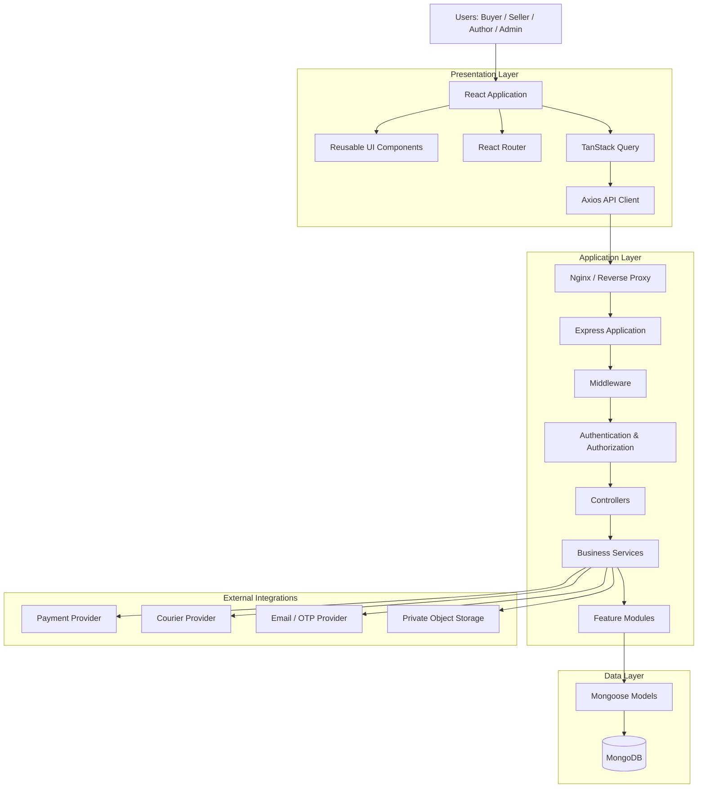

# BOOK BAZAR – SYSTEM DESIGN AND ARCHITECTURE

**Document Version:** 1.0
**Project:** Book Bazar
**Document Type:** System Design and Architecture
**Architecture Pattern:** Modular Monolithic Architecture
**Programming Language:** JavaScript (ES6+)
**Database:** MongoDB
**Deployment:** Docker and Docker Compose
**Status:** Initial Architecture Baseline

---

# 1. Introduction

## 1.1 Purpose

This document defines the overall system architecture of Book Bazar.

It describes the major application components, their responsibilities, communication mechanisms, database interactions, external integrations, deployment infrastructure and architectural design decisions.

## 1.2 Architectural Objectives

The architecture must:

- Maintain independent frontend and backend applications.
- Support multiple user capabilities.
- Provide secure RESTful API communication.
- Maintain modular backend business logic.
- Use MongoDB for persistent storage.
- Support transactional business operations.
- Provide reusable frontend components.
- Support Docker-based development and deployment.
- Allow future functionality without major architectural restructuring.

# 2. High-Level System Architecture

Book Bazar will follow a three-tier application architecture.

1. Presentation Layer – React frontend.
2. Application Layer – Node.js and Express backend.
3. Data Layer – MongoDB database.

External services will be integrated through dedicated backend modules.

## 2.1 System Architecture Diagram



# 3. Frontend Architecture

## 3.1 Frontend Responsibilities

The frontend is responsible for:

- Displaying application interfaces.
- Managing user navigation.
- Collecting user information.
- Performing client-side validation.
- Managing presentation state.
- Fetching backend data.
- Displaying loading and error states.
- Managing authenticated application experiences.
- Providing responsive interfaces.

## 3.2 Frontend Technology

| Component            | Technology      |
| -------------------- | --------------- |
| UI Framework         | React           |
| Programming Language | JavaScript      |
| Build Tool           | Vite            |
| Styling              | Tailwind CSS    |
| Icons                | Lucide React    |
| Routing              | React Router    |
| API Communication    | Axios           |
| Server State         | TanStack Query  |
| Form Handling        | React Hook Form |
| Validation           | Zod             |

## 3.3 Frontend Module Structure

The frontend will be organized into feature-oriented modules.

```text
apps/web/src/
│
├── assets/
│
├── components/
│   ├── common/
│   ├── layout/
│   ├── navigation/
│   └── ui/
│
├── features/
│   ├── auth/
│   ├── users/
│   ├── books/
│   ├── categories/
│   ├── listings/
│   ├── cart/
│   ├── wishlist/
│   ├── checkout/
│   ├── orders/
│   ├── payments/
│   ├── seller/
│   ├── author/
│   ├── admin/
│   └── notifications/
│
├── hooks/
├── layouts/
├── pages/
├── routes/
├── services/
├── context/
├── utils/
├── constants/
│
├── App.jsx
└── main.jsx
```

## 3.4 Frontend Component Responsibilities

### Components

Reusable interface elements such as:

- Buttons.
- Input fields.
- Modals.
- Cards.
- Navigation bars.
- Sidebars.
- Book cards.
- Loading indicators.
- Pagination controls.

### Pages

Represent complete application screens such as:

- Homepage.
- Login.
- Registration.
- Explore Books.
- Book Details.
- Cart.
- Checkout.
- Buyer Dashboard.
- Seller Dashboard.
- Author Dashboard.
- Admin Dashboard.

### Features

Each feature contains its own relevant UI, hooks, services and validation logic where appropriate.

### Services

Frontend services communicate with backend APIs through a centralized Axios instance.

### Hooks

Custom hooks encapsulate reusable application logic.

# 4. Backend Architecture

## 4.1 Backend
