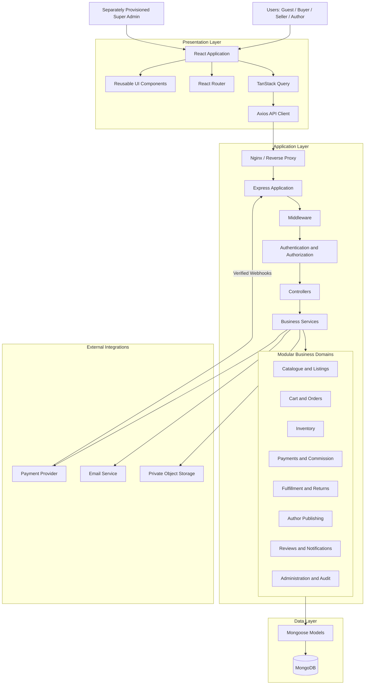
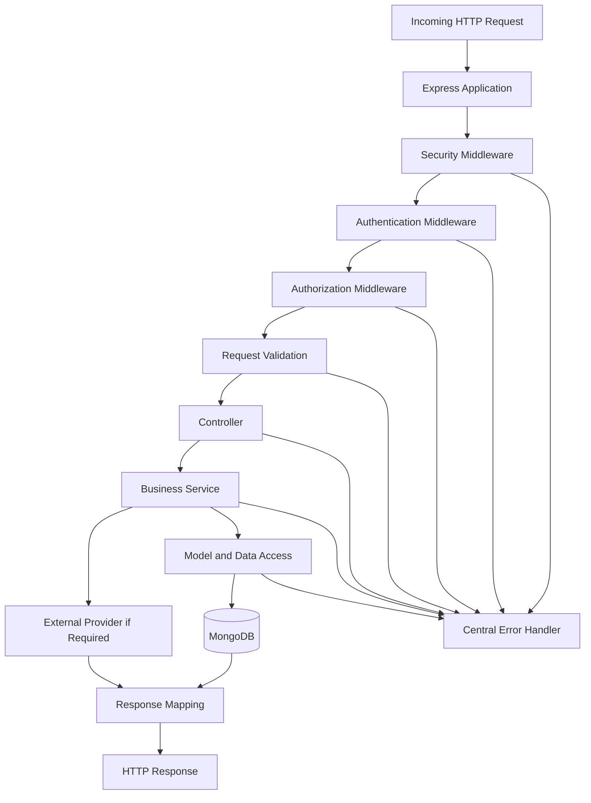
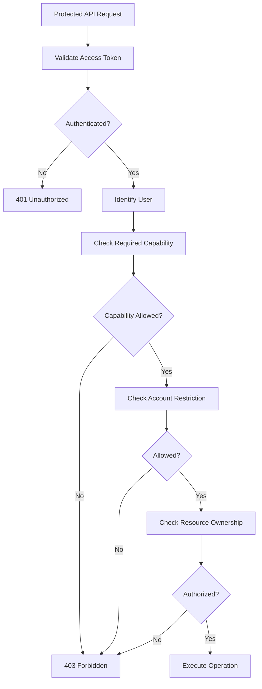
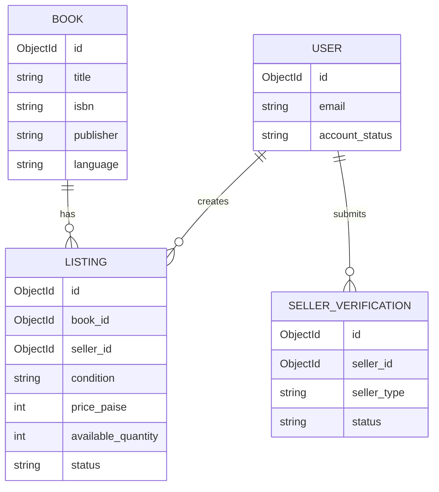
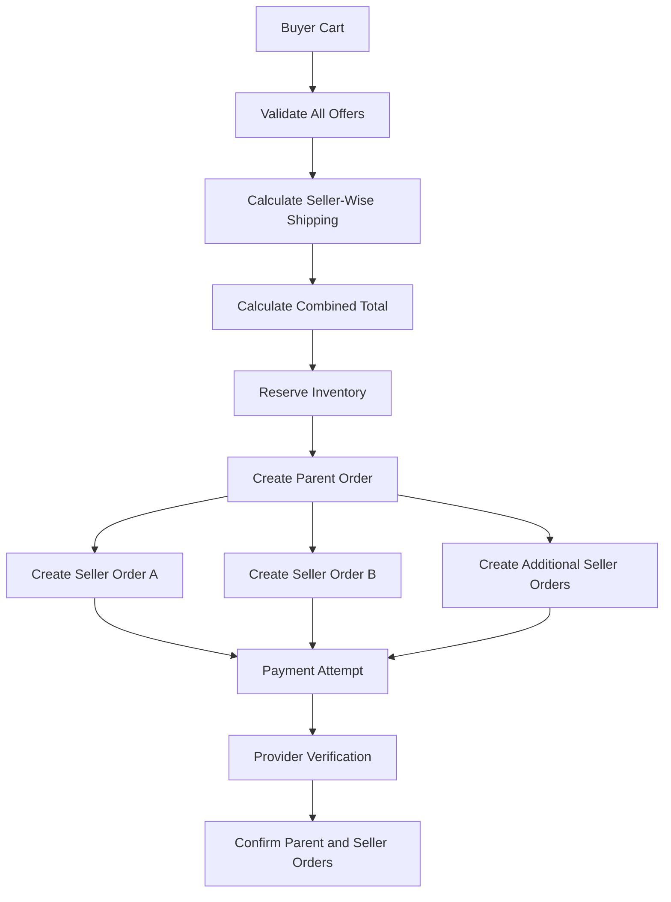
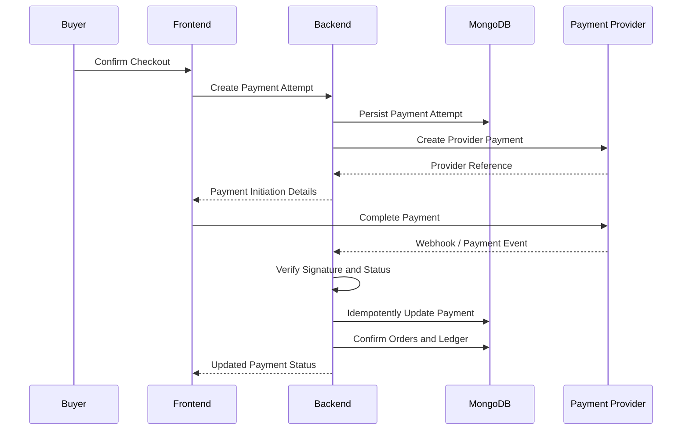
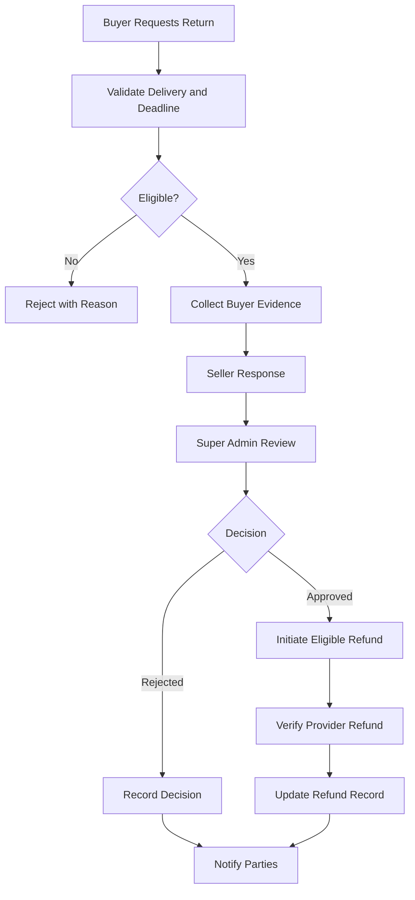
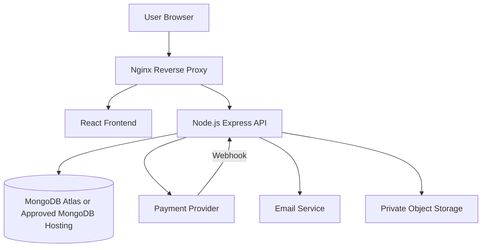

# BOOK BAZAR — SYSTEM DESIGN AND ARCHITECTURE

**Document Version:** 2.0
**Project:** Book Bazar
**Document Type:** System Design and Architecture
**Architecture Pattern:** Modular Monolithic Architecture
**Programming Language:** JavaScript ES6+
**Database:** MongoDB
**Deployment:** Docker and Docker Compose
**Status:** Approved Logical Architecture Baseline
**Last Updated:** 20 November 2026

---

# 1. Introduction

## 1.1 Purpose

This document defines the overall system architecture of Book Bazar.

It describes the application layers, frontend and backend responsibilities, business modules, communication mechanisms, database interactions, external integrations, security boundaries, deployment infrastructure and architectural decisions.

It provides a technical blueprint for implementing the Book Bazar marketplace while preserving separation of responsibilities and data integrity.

## 1.2 Architectural Objectives

The architecture shall:

- Maintain independent frontend and backend applications.
- Support Buyer, Seller and Author capabilities on one account.
- Provide separate Super Admin access.
- Provide secure RESTful API communication.
- Maintain modular backend business logic.
- Use MongoDB for persistent storage.
- Support transactional business operations.
- Provide reusable frontend components.
- Support payment verification and reconciliation.
- Maintain reliable inventory and financial records.
- Support seller-managed fulfillment.
- Protect sensitive documents and personal information.
- Support Docker-based development and deployment.
- Allow future functionality without requiring premature microservices.

## 1.3 Architectural Principles

1. Separation of concerns.
2. Modular monolithic design.
3. Backend-controlled business rules.
4. Secure-by-default implementation.
5. Database consistency.
6. Idempotent financial operations.
7. Immutable completed financial records.
8. Capability-based authorization.
9. Explicit external integration boundaries.
10. Testability and maintainability.
11. Documentation-driven development.
12. Backward compatibility and regression protection.

---

# 2. High-Level System Architecture

Book Bazar follows a three-tier application architecture:

1. **Presentation Layer:** React frontend.
2. **Application Layer:** Node.js and Express backend.
3. **Data Layer:** MongoDB database.

External services are integrated through dedicated backend service modules.

## 2.1 System Architecture Diagram



## 2.2 Architecture Description

The frontend communicates with the backend through REST APIs.

The backend processes requests through authentication, authorization, validation, controllers and business services.

Business services interact with MongoDB through Mongoose models and communicate with approved external providers where required.

The backend remains the authority for:

- User authorization.
- Listing eligibility.
- Inventory availability.
- Checkout validation.
- Payment verification.
- Commission calculation.
- Order state transitions.
- Refund eligibility.
- Seller payout eligibility.
- Administrative actions.

## 2.3 Architectural Style

The backend will use a modular monolithic architecture.

All initial business domains operate within one Express application and one deployment unit, while maintaining separate responsibilities and module boundaries.

The initial architecture does not require:

- Independent microservices.
- Distributed service discovery.
- A separate message broker.
- Redis.
- Kubernetes.

Additional infrastructure may be considered later if actual scale or operational requirements justify it.

---

# 3. Frontend Architecture

## 3.1 Frontend Responsibilities

The frontend is responsible for:

- Displaying application interfaces.
- Managing user navigation.
- Collecting user information.
- Performing client-side validation.
- Managing presentation state.
- Fetching backend data.
- Displaying loading and error states.
- Managing authenticated application experiences.
- Providing responsive interfaces.
- Displaying functionality according to active capabilities.
- Initiating supported user actions through APIs.

The frontend shall not independently determine payment success, commission, inventory availability or payout completion.

## 3.2 Frontend Technology

| Component            | Technology      |
| -------------------- | --------------- |
| UI Framework         | React           |
| Programming Language | JavaScript ES6+ |
| Build Tool           | Vite            |
| Styling              | Tailwind CSS    |
| Icons                | Lucide React    |
| Routing              | React Router    |
| API Communication    | Axios           |
| Server State         | TanStack Query  |
| Form Handling        | React Hook Form |
| Validation           | Zod             |

## 3.3 Frontend Module Structure

The following is the recommended logical organization. Existing source files must be inspected before any restructuring.

```text
apps/web/src/
│
├── assets/
│
├── components/
│   ├── common/
│   ├── layout/
│   ├── navigation/
│   └── ui/
│
├── features/
│   ├── authentication/
│   ├── users/
│   ├── addresses/
│   ├── catalogue/
│   ├── categories/
│   ├── listings/
│   ├── search/
│   ├── cart/
│   ├── wishlist/
│   ├── checkout/
│   ├── orders/
│   ├── payments/
│   ├── seller/
│   ├── inventory/
│   ├── author/
│   ├── reviews/
│   ├── notifications/
│   └── admin/
│
├── hooks/
├── layouts/
├── pages/
├── routes/
├── services/
├── context/
├── schemas/
├── utils/
├── constants/
│
├── App.jsx
└── main.jsx
```

## 3.4 Frontend Component Responsibilities

### Components

Reusable interface elements:

- Buttons.
- Input fields.
- Modals.
- Cards.
- Navigation bars.
- Sidebars.
- Book cards.
- Loading indicators.
- Pagination controls.

### Pages

Complete application screens:

- Homepage.
- Login.
- Registration.
- Explore Books.
- Book Details.
- Cart.
- Checkout.
- Buyer Dashboard.
- Seller Dashboard.
- Author Dashboard.
- Super Admin Dashboard.

### Features

Feature modules contain their relevant UI, hooks, services and validation logic where appropriate.

### Services

Frontend services communicate with backend APIs through a centralized Axios instance.

### Hooks

Custom hooks encapsulate reusable application logic.

## 3.5 Routing and Capability-Aware Navigation

React Router manages client-side navigation.

Routes shall be separated into:

- Public routes.
- Authenticated routes.
- Buyer routes.
- Seller routes.
- Author routes.
- Super Admin routes.

Buyer, Seller and Author routes may be available simultaneously when the account possesses the respective capabilities.

Super Admin routes require separate administrative authorization.

Frontend route guards improve user experience but do not replace backend authorization.

---

# 4. Backend Architecture

## 4.1 Backend Responsibilities

The backend is responsible for:

- Authentication and authorization.
- User and capability management.
- Request validation.
- Business rules.
- Database operations.
- Catalogue and listing management.
- Inventory reservation.
- Cart and checkout.
- Order creation.
- Payment verification.
- Commission calculation.
- Seller fulfillment.
- Returns and refunds.
- Seller earnings and payouts.
- Author publishing.
- Reviews and ratings.
- Notifications.
- Support and disputes.
- Administrative governance.
- Audit logging.

## 4.2 Backend Technology

| Component        | Technology      |
| ---------------- | --------------- |
| Runtime          | Node.js         |
| Framework        | Express         |
| Language         | JavaScript ES6+ |
| Database         | MongoDB         |
| ODM              | Mongoose        |
| Authentication   | JWT             |
| Password Hashing | bcryptjs        |
| Validation       | Zod             |
| File Upload      | Multer          |
| Security Headers | Helmet          |
| Email            | Nodemailer      |

## 4.3 Backend Request Lifecycle



## 4.4 Backend Module Responsibilities

### Authentication Module

- Registration.
- Login.
- Email verification.
- Password recovery.
- Session management.
- Token refresh.
- Logout.

### User Module

- User profiles.
- Account settings.
- Capability management.
- Account status.
- Privacy requests.

### Catalogue Module

- Book catalogue.
- Catalogue information.
- Book metadata.
- Catalogue entry review.

### Listing Module

- Seller listings.
- Book condition.
- Fixed prices.
- Seller-specific descriptions.
- Listing status.

### Inventory Module

- Available stock.
- Reserved stock.
- Inventory updates.
- Reservation expiration.
- Inventory history.

### Cart and Checkout Module

- Unified cart.
- Multi-seller grouping.
- Price validation.
- Shipping calculation.
- Checkout validation.
- Reservation initiation.

### Order Module

- Parent orders.
- Seller orders.
- Order snapshots.
- Order lifecycle.
- Order history.

### Payment Module

- Payment attempts.
- Provider integration.
- Webhook verification.
- Payment state transitions.
- Payment reconciliation.

### Commission Module

- Commission calculation.
- First-transaction entitlement.
- Commission ledger.
- Financial adjustments.

### Fulfillment Module

- Seller order processing.
- Dispatch information.
- Tracking information.
- Delivery status.
- Dispatch evidence.

### Returns and Refunds Module

- Cancellation requests.
- Return requests.
- Disputes.
- Refund eligibility.
- Refund processing.

### Payout Module

- Seller earnings.
- Payout eligibility.
- Payout destinations.
- Settlement requests.
- Payout history.

### Author Module

- Author capability.
- Publication submissions.
- Authorship evidence.
- Publication review.
- Public author profiles.

### Review Module

- Book ratings.
- Seller ratings.
- Review eligibility.
- Review moderation.

### Notification Module

- In-app notifications.
- Email notifications.
- Notification preferences.
- Duplicate event prevention.

### Administration Module

- Super Admin operations.
- Seller verification review.
- Publication review.
- User restrictions.
- Policy configuration.
- Financial oversight.
- Appeals.

### Audit Module

- Administrative action records.
- Financial audit records.
- Security event history.
- State transition history.

## 4.5 Backend Folder Organization

The existing implementation must be inspected before creating or moving modules.

Recommended logical organization:

```text
apps/api/src/
│
├── config/
├── models/
├── routes/
├── controllers/
├── services/
├── middleware/
├── validators/
├── utils/
├── modules/
│   ├── authentication/
│   ├── users/
│   ├── addresses/
│   ├── catalogue/
│   ├── categories/
│   ├── listings/
│   ├── inventory/
│   ├── cart/
│   ├── wishlist/
│   ├── checkout/
│   ├── orders/
│   ├── payments/
│   ├── commissions/
│   ├── fulfillment/
│   ├── returns/
│   ├── payouts/
│   ├── authors/
│   ├── reviews/
│   ├── notifications/
│   ├── support/
│   └── admin/
│
├── app.js
└── server.js
```

---

# 5. Application Layer Communication

## 5.1 Frontend-to-Backend Communication

The React frontend communicates with Express through HTTP REST APIs.

Communication shall use:

- JSON request bodies.
- JSON responses.
- HTTP status codes.
- Access authentication.
- Secure refresh cookies.
- Standardized error responses.

## 5.2 API Versioning

The initial API prefix shall be:

`/api/v1`

Versioning allows future API evolution while maintaining a documented contract.

## 5.3 Backend Internal Communication

Backend modules communicate through service interfaces and controlled function calls.

Business modules should not directly manipulate another module's internal data structures without following the relevant service responsibilities and validation rules.

## 5.4 External Provider Communication

External provider communication must occur through backend integration services.

The frontend must not receive private provider credentials.

---

# 6. Data Layer Architecture

## 6.1 Database Technology

MongoDB is the primary persistent database.

Mongoose provides:

- Schema definitions.
- Data validation.
- Model operations.
- Relationships and references.
- Index management.
- Timestamps.

## 6.2 Logical Data Domains

The database shall be organized around these logical domains:

1. Identity and authentication.
2. User capabilities and profiles.
3. Addresses.
4. Book catalogue.
5. Categories.
6. Seller listings.
7. Seller inventory.
8. Shopping carts.
9. Wishlists.
10. Checkout and reservations.
11. Parent orders.
12. Seller orders.
13. Payment attempts and transactions.
14. Commission and entitlement ledger.
15. Refunds.
16. Seller earnings and payouts.
17. Author profiles and publications.
18. Reviews and ratings.
19. Notifications.
20. Support and disputes.
21. Administrative audit records.

Detailed collections, schemas, indexes and relationships are governed by `docs/database/database-design.md`.

## 6.3 Data Consistency

Critical operations must maintain consistency across related documents.

Examples include:

- Inventory reservation.
- Parent and seller order creation.
- Payment confirmation.
- Commission ledger creation.
- Refund processing.
- Payout accounting.

MongoDB transactions or appropriate atomic operations shall be used where required.

## 6.4 Monetary Representation

All monetary values shall be stored as integer paise.

Floating-point arithmetic shall not be used for financial calculations.

## 6.5 Financial Record Integrity

Completed financial transactions shall be immutable.

Corrections shall be represented through separate adjustment or reversal records.

The system shall maintain traceability for:

- Payment attempts.
- Successful payments.
- Commission.
- Entitlement consumption.
- Refunds.
- Earnings.
- Payouts.

---

# 7. Authentication and Authorization Architecture

## 7.1 Account Model

One registered user account may contain:

- Buyer capability.
- Seller capability.
- Author capability.

Buyer is the default capability.

Seller and Author capabilities may be activated independently.

Super Admin is separately provisioned and uses a dedicated administrative login.

## 7.2 Authentication Mechanism

The system shall use:

- JWT access authentication.
- Refresh-token-based session renewal.
- bcryptjs password hashing.
- Email verification.
- Password reset tokens.
- Session management.
- Secure logout.

## 7.3 Authorization Flow



## 7.4 Administrative Security

Super Admin operations require:

- Dedicated authentication.
- Mandatory MFA on every login.
- Protected administrative APIs.
- Secure recovery.
- Audit logging.

Authentication-specific design is maintained in the six documents under `docs/authentication/`.

---

# 8. Marketplace Business Architecture

## 8.1 Catalogue and Seller Listing Separation

The catalogue represents a book's shared identity and metadata.

A seller listing represents an individual offer for that book.



One catalogue book may have multiple seller listings.

Each listing maintains independent:

- Price.
- Condition.
- Quantity.
- Shipping information.
- Seller description.
- Listing status.

## 8.2 Discovery

The marketplace queries active catalogue entries with eligible seller offers.

Book cards display the lowest currently available offer and the number of available offers.

The detail page displays eligible seller offers.

Books without active seller offers are hidden from purchasable results.

All marketplace data must be database-backed.

---

# 9. Cart, Checkout and Inventory Architecture

## 9.1 Unified Cart

The buyer has one logical cart that can contain listings from multiple sellers.

The cart groups offers by seller for presentation and shipping calculation.

Adding an item to the cart does not reserve inventory.

## 9.2 Inventory Reservation

Inventory is reserved only when checkout begins.

Reservation duration: **15 minutes**.

The reservation operation must:

1. Validate the seller listing.
2. Validate current availability.
3. Atomically reserve the requested quantity.
4. Create a reservation record.
5. Associate the reservation with checkout.
6. Set the expiration timestamp.

## 9.3 Reservation Expiration

The backend must explicitly identify expired reservations and restore available inventory.

A MongoDB TTL index may be used for eventual document cleanup, but TTL deletion alone cannot release stock.

## 9.4 Multi-Seller Checkout



The parent order represents the complete buyer transaction.

Each seller order represents an individual seller's fulfillment responsibility.

---

# 10. Payment and Financial Architecture

## 10.1 Payment Provider Boundary

Cashfree Easy Split is the preferred candidate, not a finalized provider.

The architecture shall isolate provider-specific operations behind a payment integration service.

Provider selection depends on verification of:

- Marketplace eligibility.
- UPI-only seller onboarding.
- Weekly deferred settlement.
- Pricing.
- Multi-seller split capabilities.
- Refund handling.
- Webhook and reconciliation support.

## 10.2 Payment Flow



## 10.3 Payment Verification

The backend shall:

- Verify provider signatures.
- Validate provider transaction references.
- Validate amounts and currency.
- Process events idempotently.
- Handle duplicate webhooks.
- Handle out-of-order events.
- Handle late-success events.
- Reconcile provider records with local transactions.

Frontend redirects and callbacks are not sufficient evidence of successful payment.

## 10.4 Commission Architecture

The default seller commission is 10% of net book selling price after seller-funded discounts, excluding delivery charges and separately collected taxes.

The entitlement service tracks the first successful transaction across purchases and sales.

- First successful purchase consumes the entitlement without a buyer fee waiver.
- First eligible sale receives a commission waiver if the entitlement remains unused.
- Later eligible sales use the standard commission.

## 10.5 Payment Receipts

After verified payment success:

1. Persist successful payment information.
2. Confirm the corresponding order records.
3. Record financial ledger entries.
4. Generate a unique payment receipt.
5. Deliver the receipt by email.
6. Make the receipt downloadable from buyer order history.

Receipt generation and delivery must be idempotent.

## 10.6 External Side-Effect Coordination

External payment calls and database transactions must be coordinated through durable application states.

The application shall not assume that an external provider call can be rolled back by a MongoDB transaction.

Idempotency, retries and reconciliation shall protect the system from partial failures.

---

# 11. Order and Fulfillment Architecture

## 11.1 Parent and Seller Orders

One checkout produces:

- One parent order.
- One seller order per participating seller.

Each seller order maintains independent fulfillment information.

## 11.2 Status Separation

The system shall maintain separate state models for:

- Payment.
- Parent order.
- Seller order.
- Shipment.
- Refund.
- Payout.

## 11.3 Seller-Managed Delivery

The initial release uses seller-managed delivery.

Sellers are responsible for:

- Packaging.
- Selecting a courier or delivery arrangement.
- Dispatching books.
- Entering courier and tracking details.
- Providing dispatch evidence.
- Reporting delays.

The platform maintains shipment status, notifications, dispute handling and enforcement.

There is no mandatory platform courier-booking service or courier-provider integration in the initial architecture.

## 11.4 Dispatch Deadline

Sellers must dispatch within three business days after confirmed payment.

The platform may issue reminders, escalate overdue orders and notify buyers.

---

# 12. Returns, Refunds and Payout Architecture

## 12.1 Return Window

The proposed platform return window is three calendar days after delivery, subject to applicable Indian consumer law.

## 12.2 Return and Dispute Flow



## 12.3 Seller Payout Eligibility

Seller proceeds become eligible after:

- Delivery confirmation.
- Completion of the three-calendar-day return window.
- Dispute and refund checks.
- Chargeback checks.
- Removal of valid payout holds.

## 12.4 Payout Settlement

- Weekly settlement is the target.
- No platform-defined minimum payout.
- UPI ID/VPA is preferred, subject to provider support.
- Changed payout destinations require re-verification.
- Payout success must be confirmed through trusted provider information.

---

# 13. Author Publishing Architecture

## 13.1 Author Capability

Author is an independent capability associated with a registered account.

## 13.2 Publication Submission

Authors submit:

- Publication details.
- Authorship declaration.
- Ownership declaration.
- Supporting evidence.
- Applicable copyright or permission information.

## 13.3 Review

The Super Admin reviews:

- Authorship and ownership.
- Copyright concerns.
- Plagiarism.
- Legal compliance.
- Misrepresentation.
- Missing permissions.
- Policy violations.

## 13.4 Public Profile

After the first publication approval, the system creates or activates a public author profile.

Authors may manage optional biography, photograph and genres.

## 13.5 Printing Responsibility

Authors arrange and fund their own physical printing.

Digital publishing is outside the initial architecture and shall be implemented only in a future approved phase.

---

# 14. Reviews, Notifications and Support Architecture

## 14.1 Reviews

Only verified purchasers with successful purchases and confirmed delivery may submit reviews.

Book ratings are catalogue-level. Seller ratings are seller-specific.

Review moderation is managed through Super Admin operations.

## 14.2 Notifications

Initial channels:

- In-app notifications.
- Email notifications.

Push notifications may be introduced in a future phase.

Notifications are generated from relevant application events and must avoid duplicates.

## 14.3 Support

The support module manages:

- Support tickets.
- Order-related complaints.
- Dispute communication.
- Evidence attachments.
- Grievance submissions.
- Resolution history.

Operational response targets shall comply with statutory requirements.

---

# 15. Administration and Audit Architecture

## 15.1 Super Admin

The initial system supports one separately provisioned Super Admin.

The Super Admin manages:

- User and capability restrictions.
- Seller verification.
- Author publication review.
- Listing and catalogue moderation.
- Payments and financial oversight.
- Eligible refunds.
- Payout holds.
- Platform policies.
- Analytics and reporting.
- Appeals.

## 15.2 Policy Configuration

Configurable policies include:

- Commission rate.
- Dispatch deadline.
- Return window, subject to law.
- Categories.
- Listing rules.
- Minimum listing price.
- Seller eligibility.
- Publishing guidelines.
- Notification templates.
- Announcements.

Policy changes require effective dates and audit records. Completed transactions must not be retroactively changed.

## 15.3 Audit Records

Sensitive actions must record:

- Actor.
- Action.
- Affected entity.
- Timestamp.
- Reason.
- Relevant reference.

Financial records must remain immutable. Adjustments and reversals are separate records.

---

# 16. Security Architecture

## 16.1 Security Layers

Security is enforced at multiple layers:

1. Frontend route and presentation restrictions.
2. API authentication.
3. Capability authorization.
4. Resource ownership validation.
5. Request validation.
6. Database access controls.
7. External provider verification.
8. Audit logging.

## 16.2 Application Security

The system shall implement:

- Secure password hashing.
- JWT authentication.
- Refresh-token rotation.
- Session revocation.
- Helmet security headers.
- CORS allowlisting.
- Rate limiting.
- Request validation.
- Secure file upload validation.
- Protected private storage.
- Centralized error handling.

## 16.3 Secrets Management

- Environment files shall remain outside version control.
- `.env.example` shall contain placeholders only.
- Credentials must not be committed or logged.
- Suspected exposed credentials must be rotated.
- Production secrets shall use approved secure configuration.

## 16.4 Privacy

Personal information shall be collected and exposed only as required.

Verification documents, payout information and dispute evidence must be restricted to authorized access.

Account deletion shall preserve records required by applicable law.

---

# 17. Background Processing Architecture

Some workflows require processing beyond an immediate HTTP request.

These include:

- Expired inventory reservation release.
- Payment reconciliation.
- Retry of recoverable notifications.
- Payout processing.
- Late-dispatch monitoring.
- Time-based eligibility evaluation.

The initial architecture shall use controlled application-level processing.

The exact worker and scheduling implementation shall be selected during technical implementation.

Background processing must:

- Be idempotent.
- Record execution outcomes.
- Handle retries safely.
- Avoid duplicate financial operations.
- Preserve auditability.
- Recover from interrupted execution.

A background process must never assume that deleting an expired reservation record automatically restores inventory.

---

# 18. Deployment Architecture

## 18.1 Development Environment

Development consists of:

- React/Vite frontend.
- Express backend.
- MongoDB local or Atlas database.
- Environment-based configuration.
- Email integration.
- Automated tests.

## 18.2 Containerized Deployment

Docker packages the application services.

Docker Compose coordinates local services and supported deployment environments.

## 18.3 Production Architecture



## 18.4 Deployment Components

| Component        | Responsibility                      |
| ---------------- | ----------------------------------- |
| Nginx            | Reverse proxy and frontend delivery |
| React/Vite Build | Frontend application                |
| Node.js/Express  | Backend API                         |
| MongoDB          | Persistent data                     |
| Payment Provider | Payment and settlement processing   |
| Email Service    | Transactional communication         |
| Object Storage   | File and image storage              |
| Docker           | Containerization                    |
| Docker Compose   | Service orchestration               |

Final hosting and service-provider selections remain subject to cost, security and operational review.

---

# 19. Testing Architecture

## 19.1 Testing Layers

| Testing Type        | Tool                  |
| ------------------- | --------------------- |
| Unit Testing        | Vitest                |
| Backend Integration | Vitest and Supertest  |
| Frontend Components | React Testing Library |
| End-to-End          | Playwright            |
| Manual API Testing  | Postman               |

## 19.2 Critical Test Areas

- Authentication and session management.
- Capability authorization.
- Seller verification.
- Catalogue and listing management.
- Inventory concurrency.
- Checkout and multi-seller order creation.
- Payment idempotency.
- Payment webhook verification.
- Commission and entitlement.
- Seller fulfillment.
- Returns and refunds.
- Payout eligibility.
- Author publishing.
- Reviews.
- Super Admin security.
- Audit and financial integrity.

## 19.3 Regression Testing

Every relevant change must be tested against existing functionality.

Architecture or module changes must not silently break existing authentication, database connectivity, application startup or other working features.

---

# 20. Architecture Decisions and Constraints

| Decision           | Approved Position                                      |
| ------------------ | ------------------------------------------------------ |
| Architecture       | Modular monolith                                       |
| Frontend           | React and Vite                                         |
| Backend            | Node.js and Express                                    |
| Language           | JavaScript ES6+                                        |
| Database           | MongoDB                                                |
| Data Layer         | Mongoose                                               |
| API                | Versioned REST                                         |
| Account Model      | Buyer, Seller and Author capabilities on one account   |
| Admin Model        | Separate Super Admin                                   |
| Marketplace        | Multi-vendor physical books                            |
| Pricing            | Fixed price                                            |
| Cart               | Unified multi-seller cart                              |
| Orders             | Parent order and seller orders                         |
| Inventory          | 15-minute checkout reservation                         |
| Delivery           | Seller-managed                                         |
| Commission         | 10% default                                            |
| First Transaction  | Shared purchase/sale entitlement                       |
| Seller Payout      | Weekly target                                          |
| Payout Minimum     | No platform-defined minimum                            |
| Payment Provider   | Cashfree Easy Split preferred candidate, not finalized |
| Author Publishing  | Physical books initially                               |
| Digital Publishing | Future phase                                           |
| Deployment         | Docker and Docker Compose                              |

## 20.1 Technology Exclusions

The initial architecture shall not introduce these as core stack replacements:

- TypeScript.
- PostgreSQL.
- Prisma.
- Redis.
- Microservices.

Any change requires explicit technical review and approval.

---

# 21. Future Architecture Evolution

Future expansion may include:

- Digital publishing.
- Push notifications.
- Additional payment providers.
- Additional delivery integrations if required.
- Advanced marketplace analytics.
- Additional operational roles.
- Dedicated background-processing infrastructure.
- Additional deployment and scaling mechanisms.

These changes must be introduced through documented architecture decisions and must not compromise existing business rules or financial integrity.

---

# 22. Architecture Acceptance Criteria

The architecture shall be considered correctly implemented when:

1. Frontend, backend and database responsibilities are separated.
2. The backend uses modular business domains.
3. Authentication and authorization are enforced server-side.
4. Multiple marketplace capabilities coexist on one account.
5. Super Admin access remains separate.
6. Catalogue and seller listing data are separated.
7. Inventory reservation is atomic and time-limited.
8. Expired reservations are explicitly released.
9. Multi-seller checkout creates correct parent and seller orders.
10. Payment verification is trusted and idempotent.
11. Financial records are auditable and immutable.
12. Seller-managed delivery is supported.
13. Returns, refunds and payouts follow approved rules.
14. External provider integrations are isolated.
15. Private documents remain protected.
16. Critical workflows have automated tests.
17. Deployment can be reproduced using the approved infrastructure.
18. Existing working application functionality remains operational.

---

# 23. Document Governance

| Field        | Value                                  |
| ------------ | -------------------------------------- |
| Document     | System Design and Architecture         |
| Project      | Book Bazar                             |
| Version      | 2.0                                    |
| Status       | Approved Logical Architecture Baseline |
| Owner        | Book Bazar Project Team                |
| Last Updated | 20 November 2026                       |
| Next Review  | Before detailed implementation         |

**End of Document**
