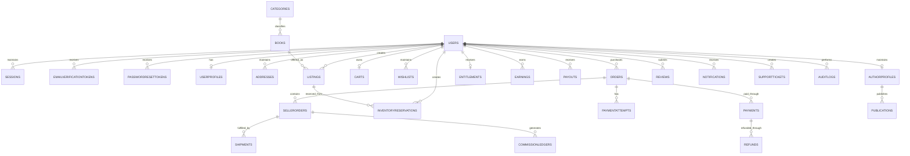
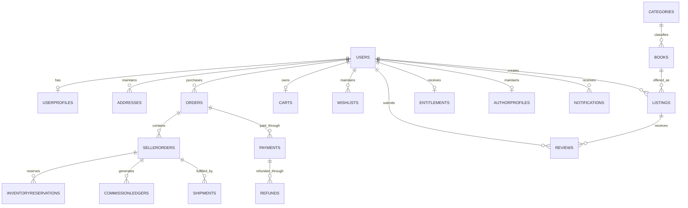

# BOOK BAZAR — DATABASE DESIGN DOCUMENT

**Document Version:** 2.0
**Project:** Book Bazar
**Database:** MongoDB
**ODM:** Mongoose
**Database Architecture:** Document-Oriented Database
**Status:** Approved Logical Database Baseline
**Last Updated:** 20 November 2026

---

# 1. Introduction

## 1.1 Purpose

This document defines the database architecture and data management strategy of Book Bazar.

It specifies:

- MongoDB collections.
- Mongoose schema responsibilities.
- Field definitions and data types.
- Document relationships.
- Validation rules.
- Database indexes.
- Data integrity requirements.
- Transaction management.
- Financial data management.
- Security and retention considerations.

## 1.2 Database Objectives

The database must:

1. Support multiple capabilities on one user account.
2. Preserve existing authentication functionality.
3. Maintain independent book catalogue and seller listing records.
4. Support multi-seller shopping and order processing.
5. Maintain accurate inventory.
6. Support secure payment records.
7. Maintain auditable commission transactions.
8. Enforce first-transaction entitlement rules.
9. Support seller-managed shipment information.
10. Support physical author publishing.
11. Maintain data consistency during concurrent operations.
12. Support administrative governance and audit records.

## 1.3 Database Technology

| Component              | Technology                        |
| ---------------------- | --------------------------------- |
| Primary Database       | MongoDB                           |
| ODM                    | Mongoose                          |
| Database GUI           | MongoDB Compass                   |
| Local Database         | Dockerized MongoDB                |
| Production Database    | MongoDB Atlas or approved hosting |
| Query Management       | Mongoose                          |
| Transaction Management | MongoDB Sessions and Transactions |

## 1.4 Database Naming

Logical database name:

`book_bazar`

Existing development environments may use a different database name through environment configuration. Database naming must be consistent within each environment.

Collection naming convention:

- users
- sessions
- emailverificationtokens
- passwordresettokens
- userprofiles
- addresses
- sellerverifications
- books
- categories
- listings
- carts
- wishlists
- inventoryreservations
- orders
- sellerorders
- paymentattempts
- payments
- refunds
- commissionledgers
- entitlements
- shipments
- payoutdestinations
- payouts
- earnings
- authorprofiles
- publications
- reviews
- notifications
- supporttickets
- disputes
- auditlogs
- policyversions

Mongoose model names shall use PascalCase, with explicit collection names where appropriate.

---

# 2. Database Architecture Overview

The database follows a document-oriented design.

MongoDB documents will use references for independently managed entities and embedded documents for suitable snapshots and tightly related information.

## 2.1 High-Level Entity Relationship Diagram



The diagram represents logical relationships. It does not require every relationship to be implemented as a relational foreign key.

---

# 3. Existing Authentication Database Baseline

The following collections are already represented by existing Mongoose models and must be preserved during marketplace expansion.

Existing model files:

```text
apps/api/src/models/
├── User.js
├── Session.js
├── EmailVerificationToken.js
└── PasswordResetToken.js
```

## 3.1 Users Collection

**Collection:** `users`
**Model:** `User`

**Purpose:** Stores account identity, credentials, capabilities, address and account status.

### Existing Fields

| Field             | Data Type       | Description                   |
| ----------------- | --------------- | ----------------------------- |
| _id               | ObjectId        | Unique user identifier        |
| fullName          | String          | User's full name              |
| email             | String          | Normalized email address      |
| passwordHash      | String          | Hashed password               |
| address           | Embedded Object | Registration address          |
| emailVerified     | Boolean         | Email verification status     |
| capabilities      | Array of String | Buyer, Seller and Author      |
| isAdmin           | Boolean         | Existing administrative flag  |
| accountStatus     | String          | Active, suspended or disabled |
| passwordChangedAt | Date            | Password change timestamp     |
| createdAt         | Date            | Creation timestamp            |
| updatedAt         | Date            | Modification timestamp        |

### Existing Address Structure

The current User model embeds the registration address:

| Field      | Data Type | Description                 |
| ---------- | --------- | --------------------------- |
| line1      | String    | Primary address             |
| line2      | String    | Optional additional address |
| city       | String    | City                        |
| state      | String    | State                       |
| postalCode | String    | Postal code                 |
| country    | String    | Country                     |

The embedded address is required by the current registration schema.

### Existing Validation and Indexes

- Email is required.
- Email is trimmed and converted to lowercase.
- Email has a unique index.
- Password hash is required and excluded from normal query selection.
- Capabilities are restricted to `buyer`, `seller` and `author`.
- Default capability is `buyer`.
- Duplicate capability entries are rejected.
- Account status is restricted to `active`, `suspended` and `disabled`.
- Additional indexes exist on `accountStatus` and `emailVerified`.
- `isAdmin` is excluded from normal query selection.

### Future Database Evolution

The marketplace requires additional user-related information.

Possible additions include:

- Phone number and verification status.
- Seller verification status.
- Author profile reference.
- Account restriction metadata.
- Capability activation metadata.
- Privacy and consent records.

These additions must be introduced through controlled schema changes.

**Important:** The current `isAdmin` field is part of the existing implementation. The approved architecture requires separately provisioned Super Admin access. The migration from the existing administrative flag to the dedicated administrative authorization model must be planned and tested. Do not simply remove or rename the field.

## 3.2 Sessions Collection

**Collection:** `sessions`
**Model:** `Session`

**Purpose:** Maintains authenticated user sessions and refresh-token state.

### Existing Fields

| Field            | Data Type | Description                   |
| ---------------- | --------- | ----------------------------- |
| _id              | ObjectId  | Session identifier            |
| userId           | ObjectId  | Reference to User             |
| refreshTokenHash | String    | Hashed refresh token          |
| expiresAt        | Date      | Session expiration            |
| lastUsedAt       | Date      | Last usage timestamp          |
| revokedAt        | Date      | Revocation timestamp          |
| userAgent        | String    | Client user-agent information |
| createdAt        | Date      | Creation timestamp            |
| updatedAt        | Date      | Modification timestamp        |

### Existing Indexes

- Unique index on `refreshTokenHash`.
- TTL index on `expiresAt`.
- Compound index on `userId` and `revokedAt`.

### Important Rules

- Never store plaintext refresh tokens.
- Revoked sessions must not authenticate users.
- Application logic must independently verify expiration.
- TTL deletion is for cleanup, not authorization.

## 3.3 Email Verification Tokens Collection

**Collection:** `emailverificationtokens`
**Model:** `EmailVerificationToken`

**Purpose:** Stores hashed email verification tokens.

### Existing Fields

| Field     | Data Type | Description               |
| --------- | --------- | ------------------------- |
| _id       | ObjectId  | Token record identifier   |
| userId    | ObjectId  | Reference to User         |
| tokenHash | String    | Hashed verification token |
| expiresAt | Date      | Token expiration          |
| usedAt    | Date      | Token usage timestamp     |
| createdAt | Date      | Creation timestamp        |
| updatedAt | Date      | Modification timestamp    |

### Existing Indexes

- Unique index on `tokenHash`.
- TTL index on `expiresAt`.
- Compound index on `userId` and `usedAt`.

### Important Rules

- Tokens must be stored as hashes.
- Expired tokens must not be accepted.
- Used tokens must not be reused.
- Verification must update the associated user record safely.

## 3.4 Password Reset Tokens Collection

**Collection:** `passwordresettokens`
**Model:** `PasswordResetToken`

**Purpose:** Stores hashed password-reset tokens.

### Existing Fields

| Field     | Data Type | Description             |
| --------- | --------- | ----------------------- |
| _id       | ObjectId  | Token record identifier |
| userId    | ObjectId  | Reference to User       |
| tokenHash | String    | Hashed reset token      |
| expiresAt | Date      | Token expiration        |
| usedAt    | Date      | Token usage timestamp   |
| createdAt | Date      | Creation timestamp      |
| updatedAt | Date      | Modification timestamp  |

### Existing Indexes

- Unique index on `tokenHash`.
- TTL index on `expiresAt`.
- Compound index on `userId` and `usedAt`.

### Important Rules

- Store only token hashes.
- Reject expired tokens.
- Reject previously used tokens.
- Update the password hash securely.
- Update `passwordChangedAt`.
- Revoke relevant existing sessions after password reset.

---

# 4. Marketplace Identity and Profile Collections

## 4.1 UserProfiles Collection

**Collection:** `userprofiles`

**Purpose:** Stores optional profile information separately from authentication credentials.

| Field        | Data Type | Description             |
| ------------ | --------- | ----------------------- |
| _id          | ObjectId  | Profile identifier      |
| userId       | ObjectId  | Reference to User       |
| profileImage | String    | Storage reference       |
| bio          | String    | User description        |
| preferences  | Object    | Application preferences |
| createdAt    | Date      | Creation timestamp      |
| updatedAt    | Date      | Modification timestamp  |

### Relationship

One user may have one extended profile.

### Indexes

- Unique index on `userId`.

Profile information must not duplicate authentication credentials.

## 4.2 Addresses Collection

**Collection:** `addresses`

**Purpose:** Stores additional buyer delivery addresses and independently managed address records.

| Field         | Data Type | Description               |
| ------------- | --------- | ------------------------- |
| _id           | ObjectId  | Address identifier        |
| userId        | ObjectId  | User reference            |
| recipientName | String    | Recipient name            |
| phone         | String    | Contact number            |
| addressLine1  | String    | Primary address           |
| addressLine2  | String    | Additional address        |
| landmark      | String    | Landmark                  |
| city          | String    | City                      |
| state         | String    | State                     |
| postalCode    | String    | Postal code               |
| country       | String    | Country                   |
| isDefault     | Boolean   | Default address indicator |
| createdAt     | Date      | Creation timestamp        |
| updatedAt     | Date      | Modification timestamp    |

### Relationship

One user can maintain multiple addresses.

### Indexes

- Index on `userId`.
- Compound index on `userId` and `isDefault`.

### Important Rule

The existing embedded registration address must remain compatible during migration.

Checkout and order documents must retain an address snapshot so later address edits do not change historical orders.

## 4.3 SellerVerifications Collection

**Collection:** `sellerverifications`

**Purpose:** Stores seller identity and business verification submissions.

| Field              | Data Type | Description                 |
| ------------------ | --------- | --------------------------- |
| _id                | ObjectId  | Verification identifier     |
| sellerId           | ObjectId  | Reference to User           |
| sellerType         | String    | Individual or business      |
| submittedDetails   | Object    | Verification information    |
| documentReferences | Array     | Private document references |
| status             | String    | Verification state          |
| reviewReason       | String    | Review explanation          |
| reviewedBy         | ObjectId  | Super Admin reference       |
| reviewedAt         | Date      | Review timestamp            |
| createdAt          | Date      | Submission timestamp        |
| updatedAt          | Date      | Modification timestamp      |

### Verification States

- Draft.
- Pending Review.
- Under Review.
- Additional Information Required.
- Approved.
- Rejected.
- Suspended.

### Important Rules

- Seller capability may be activated before verification.
- Draft listings may be created before verification.
- Public listing visibility requires successful seller verification.
- Individual and business verification requirements may differ.
- Private documents must not be stored as public URLs.

---

# 5. Catalogue and Marketplace Collections

## 5.1 Books Collection

**Collection:** `books`

**Purpose:** Stores shared catalogue information for physical books.

| Field           | Data Type         | Description                   |
| --------------- | ----------------- | ----------------------------- |
| _id             | ObjectId          | Book identifier               |
| title           | String            | Book title                    |
| authors         | Array of String   | Author names                  |
| isbn            | String            | Optional ISBN                 |
| publisher       | String            | Publisher                     |
| edition         | String            | Edition                       |
| publicationYear | Number            | Publication year              |
| language        | String            | Language                      |
| categoryIds     | Array of ObjectId | Category references           |
| description     | String            | Book description              |
| coverImage      | String            | Catalogue cover reference     |
| pageCount       | Number            | Page count                    |
| catalogueStatus | String            | Review and availability state |
| createdAt       | Date              | Creation timestamp            |
| updatedAt       | Date              | Modification timestamp        |

### Important Rules

- Title and author names are mandatory.
- Publisher is mandatory.
- Edition is required where applicable.
- ISBN is optional.
- A cover image is required for a new catalogue entry.
- Catalogue records are independent of seller-specific offers.
- Duplicate catalogue records must be controlled through appropriate matching and review.

### Indexes

- Text or supported search indexes on title, authors, publisher and description.
- Index on ISBN where available.
- Index on category references.
- Index on catalogue status.

## 5.2 Categories Collection

**Collection:** `categories`

**Purpose:** Maintains configurable marketplace categories.

| Field            | Data Type | Description              |
| ---------------- | --------- | ------------------------ |
| _id              | ObjectId  | Category identifier      |
| name             | String    | Category name            |
| slug             | String    | Unique URL identifier    |
| description      | String    | Category description     |
| parentCategoryId | ObjectId  | Optional parent category |
| status           | String    | Active or inactive       |
| createdAt        | Date      | Creation timestamp       |
| updatedAt        | Date      | Modification timestamp   |

### Indexes

- Unique index on slug.
- Index on parent category.
- Index on status.

Categories are managed through Super Admin policy controls.

## 5.3 Listings Collection

**Collection:** `listings`

**Purpose:** Stores seller-specific offers for catalogue books.

| Field             | Data Type | Description                     |
| ----------------- | --------- | ------------------------------- |
| _id               | ObjectId  | Listing identifier              |
| bookId            | ObjectId  | Reference to Book               |
| sellerId          | ObjectId  | Reference to User               |
| condition         | String    | Book condition                  |
| pricePaise        | Number    | Fixed price in paise            |
| quantity          | Number    | Available quantity              |
| reservedQuantity  | Number    | Reserved quantity               |
| sellerDescription | String    | Seller description              |
| images            | Array     | Actual listing image references |
| disclosedDefects  | Array     | Defect disclosures              |
| dispatchLocation  | Object    | Dispatch location               |
| handlingTime      | Number    | Handling time                   |
| shippingTerms     | Object    | Seller shipping terms           |
| status            | String    | Listing state                   |
| createdAt         | Date      | Creation timestamp              |
| updatedAt         | Date      | Modification timestamp          |

### Condition Values

- New.
- Like New.
- Very Good.
- Good.
- Acceptable.

### Listing Rules

- Condition, price and quantity are mandatory.
- Actual photographs are mandatory for used and rare books.
- Defects and missing pages must be disclosed.
- Rare and collectible listings may contain additional metadata.
- Public visibility requires seller verification.
- Suspended or inactive listings cannot be purchased.

### Indexes

- Index on `bookId`.
- Index on `sellerId`.
- Compound index on `bookId`, `status` and `pricePaise`.
- Index on condition and status.
- Appropriate search indexes for listing discovery.

## 5.4 Carts Collection

**Collection:** `carts`

**Purpose:** Stores a buyer's active shopping cart.

| Field     | Data Type | Description                       |
| --------- | --------- | --------------------------------- |
| _id       | ObjectId  | Cart identifier                   |
| buyerId   | ObjectId  | Reference to User                 |
| items     | Array     | Listing references and quantities |
| updatedAt | Date      | Last modification                 |

Each cart item should reference a listing and contain the requested quantity.

Prices and availability must be revalidated during checkout.

### Indexes

- Unique index on `buyerId`.

### Important Rule

Cart entries do not reserve inventory.

## 5.5 Wishlists Collection

**Collection:** `wishlists`

**Purpose:** Stores saved catalogue books for buyers.

| Field     | Data Type | Description         |
| --------- | --------- | ------------------- |
| _id       | ObjectId  | Wishlist identifier |
| userId    | ObjectId  | Reference to User   |
| bookId    | ObjectId  | Reference to Book   |
| createdAt | Date      | Creation timestamp  |

### Indexes

- Compound unique index on `userId` and `bookId`.

---

# 6. Inventory and Checkout Collections

## 6.1 InventoryReservations Collection

**Collection:** `inventoryreservations`

**Purpose:** Tracks temporary inventory reservations during checkout.

| Field      | Data Type | Description            |
| ---------- | --------- | ---------------------- |
| _id        | ObjectId  | Reservation identifier |
| buyerId    | ObjectId  | Reference to User      |
| listingId  | ObjectId  | Reference to Listing   |
| checkoutId | ObjectId  | Checkout identifier    |
| quantity   | Number    | Reserved quantity      |
| status     | String    | Reservation state      |
| expiresAt  | Date      | Reservation expiration |
| releasedAt | Date      | Release timestamp      |
| consumedAt | Date      | Consumption timestamp  |
| createdAt  | Date      | Creation timestamp     |

### Reservation States

- Active.
- Consumed.
- Released.
- Expired.

### Rules

- No reservation during cart operations.
- Reservation duration is 15 minutes.
- Reservation must atomically reduce available quantity.
- Expired reservations must explicitly restore stock.
- Successful payment consumes the reservation.
- Duplicate release operations must not restore stock twice.

### Indexes

- Index on listing.
- Index on checkout.
- Compound index on status and expiration.
- Index on buyer.

A TTL index may be used for cleanup only after business processing has completed. TTL deletion must never be responsible for inventory restoration.

---

# 7. Order Management Collections

## 7.1 Orders Collection

**Collection:** `orders`

**Purpose:** Stores the parent order representing the complete buyer checkout.

| Field                   | Data Type         | Description                          |
| ----------------------- | ----------------- | ------------------------------------ |
| _id                     | ObjectId          | Order identifier                     |
| orderNumber             | String            | Unique public order number           |
| buyerId                 | ObjectId          | Reference to User                    |
| sellerOrderIds          | Array of ObjectId | Associated seller orders             |
| itemsSnapshot           | Array             | Purchased item snapshots             |
| deliveryAddressSnapshot | Object            | Address at checkout                  |
| bookSubtotalPaise       | Number            | Book subtotal                        |
| shippingTotalPaise      | Number            | Combined shipping                    |
| gatewayFeePaise         | Number            | Disclosed gateway fee, if applicable |
| taxTotalPaise           | Number            | Applicable tax                       |
| totalPaise              | Number            | Final payable amount                 |
| paymentStatus           | String            | Payment state                        |
| orderStatus             | String            | Parent order state                   |
| createdAt               | Date              | Creation timestamp                   |
| updatedAt               | Date              | Modification timestamp               |

### Important Rules

- One checkout creates one parent order.
- The parent order contains multiple seller orders where applicable.
- Order snapshots preserve the purchase-time information.
- Payment and fulfillment statuses remain separate.
- Historical order totals must not change when catalogue or listing prices change.

### Indexes

- Unique index on order number.
- Index on buyer and creation date.
- Index on payment status.
- Index on order status.

## 7.2 SellerOrders Collection

**Collection:** `sellerorders`

**Purpose:** Stores seller-specific fulfillment responsibilities.

| Field                   | Data Type | Description                     |
| ----------------------- | --------- | ------------------------------- |
| _id                     | ObjectId  | Seller order identifier         |
| parentOrderId           | ObjectId  | Reference to parent Order       |
| sellerId                | ObjectId  | Reference to User               |
| itemsSnapshot           | Array     | Seller-specific purchased items |
| bookSubtotalPaise       | Number    | Seller book subtotal            |
| shippingPaise           | Number    | Seller shipping charge          |
| sellerFulfillmentStatus | String    | Fulfillment state               |
| shipmentId              | ObjectId  | Optional shipment reference     |
| createdAt               | Date      | Creation timestamp              |
| updatedAt               | Date      | Modification timestamp          |

### Important Rules

- One parent order may contain multiple seller orders.
- Each seller order belongs to one seller.
- Sellers can manage only their own seller orders.
- Seller fulfillment status is independent of payment status.
- Shipping charges are stored per seller order.

### Indexes

- Index on parent order.
- Compound index on seller and creation date.
- Index on fulfillment status.

---

# 8. Payment and Financial Collections

## 8.1 PaymentAttempts Collection

**Collection:** `paymentattempts`

**Purpose:** Tracks each attempt to initiate payment for an order.

| Field           | Data Type | Description                   |
| --------------- | --------- | ----------------------------- |
| _id             | ObjectId  | Attempt identifier            |
| orderId         | ObjectId  | Reference to Order            |
| buyerId         | ObjectId  | Reference to User             |
| idempotencyKey  | String    | Unique operation key          |
| provider        | String    | Payment provider              |
| providerOrderId | String    | Provider reference            |
| amountPaise     | Number    | Expected amount               |
| currency        | String    | Currency                      |
| status          | String    | Attempt state                 |
| failureCode     | String    | Provider or application error |
| createdAt       | Date      | Creation timestamp            |
| updatedAt       | Date      | Modification timestamp        |

### Rules

- Every payment attempt must be traceable.
- Retry operations must not create duplicate financial success.
- Idempotency keys must be enforced.
- Provider references must be validated.
- Late success events must be handled safely.

### Indexes

- Unique index on idempotency key.
- Index on order.
- Index on provider order ID.
- Index on status.

## 8.2 Payments Collection

**Collection:** `payments`

**Purpose:** Stores verified payment transactions.

| Field                 | Data Type | Description                    |
| --------------------- | --------- | ------------------------------ |
| _id                   | ObjectId  | Payment identifier             |
| orderId               | ObjectId  | Reference to Order             |
| buyerId               | ObjectId  | Reference to User              |
| paymentAttemptId      | ObjectId  | Reference to PaymentAttempt    |
| provider              | String    | Provider name                  |
| providerTransactionId | String    | Provider transaction reference |
| amountPaise           | Number    | Verified amount                |
| currency              | String    | Currency                       |
| paymentMethod         | String    | Payment method                 |
| status                | String    | Payment state                  |
| paidAt                | Date      | Verified payment timestamp     |
| createdAt             | Date      | Creation timestamp             |
| updatedAt             | Date      | Modification timestamp         |

### Payment States

- Initiated.
- Pending.
- Successful.
- Failed.
- Expired.
- Refund Initiated.
- Refunded.

### Important Rules

- Payment success must be backend-verified.
- Provider webhook signatures must be validated.
- Duplicate webhook events must be idempotent.
- Provider transaction identifiers must be unique where applicable.
- Payment amounts must match expected order amounts.
- Never store card numbers, CVV or UPI PIN.

### Indexes

- Unique index on provider transaction ID where present.
- Index on order.
- Index on buyer and creation date.
- Index on status.

## 8.3 Refunds Collection

**Collection:** `refunds`

**Purpose:** Records refund requests and provider-confirmed refunds.

| Field            | Data Type | Description                    |
| ---------------- | --------- | ------------------------------ |
| _id              | ObjectId  | Refund identifier              |
| paymentId        | ObjectId  | Reference to Payment           |
| orderId          | ObjectId  | Reference to Order             |
| amountPaise      | Number    | Refund amount                  |
| reason           | String    | Refund reason                  |
| status           | String    | Refund state                   |
| providerRefundId | String    | Provider reference             |
| initiatedBy      | ObjectId  | Initiating actor               |
| processedAt      | Date      | Confirmed processing timestamp |
| createdAt        | Date      | Creation timestamp             |
| updatedAt        | Date      | Modification timestamp         |

### Rules

- Refund amounts cannot exceed eligible paid amounts.
- Refund operations must be idempotent.
- Refund initiation and refund completion are separate states.
- Original payment records must remain unchanged.
- Partial refunds must be supported where applicable.

### Indexes

- Index on payment.
- Index on order.
- Index on status.
- Unique provider refund reference where available.

---

# 9. Commission and Entitlement Collections

## 9.1 CommissionLedgers Collection

**Collection:** `commissionledgers`

**Purpose:** Records platform commission calculations and financial entries.

| Field               | Data Type | Description                    |
| ------------------- | --------- | ------------------------------ |
| _id                 | ObjectId  | Ledger identifier              |
| sellerOrderId       | ObjectId  | Reference to SellerOrder       |
| sellerId            | ObjectId  | Reference to User              |
| bookSubtotalPaise   | Number    | Eligible book selling amount   |
| sellerDiscountPaise | Number    | Seller-funded discount         |
| commissionRate      | Number    | Applicable commission rate     |
| commissionPaise     | Number    | Calculated commission          |
| waiverApplied       | Boolean   | First-sale waiver indicator    |
| calculationSnapshot | Object    | Calculation inputs             |
| entryType           | String    | Charge, adjustment or reversal |
| createdAt           | Date      | Entry timestamp                |

### Commission Rules

- Default commission is 10%.
- Calculate on net book selling price after seller-funded discounts.
- Exclude delivery charges and separately collected taxes.
- Use integer paise.
- Preserve the applied rate and calculation snapshot.
- Do not overwrite completed ledger entries.
- Adjustments must be separate entries.

### Indexes

- Index on seller.
- Index on seller order.
- Index on creation date.

## 9.2 Entitlements Collection

**Collection:** `entitlements`

**Purpose:** Tracks the first-successful-transaction entitlement for each account.

| Field           | Data Type | Description                    |
| --------------- | --------- | ------------------------------ |
| _id             | ObjectId  | Entitlement identifier         |
| userId          | ObjectId  | Reference to User              |
| entitlementType | String    | First transaction entitlement  |
| status          | String    | Available or consumed          |
| consumedByType  | String    | Purchase or sale               |
| consumedById    | ObjectId  | Relevant transaction reference |
| consumedAt      | Date      | Consumption timestamp          |
| createdAt       | Date      | Creation timestamp             |
| updatedAt       | Date      | Modification timestamp         |

### Rules

- One entitlement per account.
- A successful purchase or eligible sale consumes the entitlement.
- Purchase consumption does not create a buyer fee waiver.
- First eligible sale may receive a commission waiver.
- Consumption must be atomic.
- Duplicate transaction processing must not consume it twice.

### Indexes

- Unique index on user and entitlement type.

---

# 10. Seller Fulfillment and Payout Collections

## 10.1 Shipments Collection

**Collection:** `shipments`

**Purpose:** Stores seller-managed delivery information.

| Field            | Data Type | Description                 |
| ---------------- | --------- | --------------------------- |
| _id              | ObjectId  | Shipment identifier         |
| sellerOrderId    | ObjectId  | Reference to SellerOrder    |
| sellerId         | ObjectId  | Reference to User           |
| courierName      | String    | Courier or delivery service |
| trackingNumber   | String    | Tracking reference          |
| trackingUrl      | String    | Tracking URL, if available  |
| dispatchEvidence | Array     | Private evidence references |
| shipmentStatus   | String    | Shipment state              |
| dispatchedAt     | Date      | Dispatch timestamp          |
| deliveredAt      | Date      | Delivery timestamp          |
| createdAt        | Date      | Creation timestamp          |
| updatedAt        | Date      | Modification timestamp      |

### Rules

- Seller manages delivery.
- Tracking information is mandatory after dispatch.
- Dispatch evidence is required.
- Sellers may update only their own shipment records.
- Delivery status changes must be auditable.

The initial release does not require platform-managed courier booking.

### Indexes

- Index on seller order.
- Index on seller.
- Index on shipment status.
- Index on tracking number where appropriate.

## 10.2 PayoutDestinations Collection

**Collection:** `payoutdestinations`

**Purpose:** Stores verified seller payout destination references.

| Field              | Data Type | Description                        |
| ------------------ | --------- | ---------------------------------- |
| _id                | ObjectId  | Destination identifier             |
| sellerId           | ObjectId  | Reference to User                  |
| destinationType    | String    | UPI VPA or supported provider type |
| encryptedDetails   | String    | Protected destination data         |
| verificationStatus | String    | Verification state                 |
| verifiedAt         | Date      | Verification timestamp             |
| isActive           | Boolean   | Active destination indicator       |
| createdAt          | Date      | Creation timestamp                 |
| updatedAt          | Date      | Modification timestamp             |

### Rules

- UPI VPA is preferred, subject to provider support.
- Sensitive destination details must be protected.
- Changed destinations require re-verification.
- Payouts must be held until verification completes.
- Only authorized services may access sensitive destination information.

### Indexes

- Index on seller.
- Index on verification status.

## 10.3 Earnings Collection

**Collection:** `earnings`

**Purpose:** Maintains seller earning entries and eligibility information.

| Field                | Data Type | Description                        |
| -------------------- | --------- | ---------------------------------- |
| _id                  | ObjectId  | Earning identifier                 |
| sellerId             | ObjectId  | Reference to User                  |
| sellerOrderId        | ObjectId  | Reference to SellerOrder           |
| grossBookAmountPaise | Number    | Eligible book amount               |
| commissionPaise      | Number    | Platform commission                |
| shippingPaise        | Number    | Shipping component                 |
| netEarningPaise      | Number    | Seller earning                     |
| eligibilityAt        | Date      | Earliest eligibility timestamp     |
| status               | String    | Pending, eligible, held or settled |
| createdAt            | Date      | Creation timestamp                 |
| updatedAt            | Date      | Modification timestamp             |

Actual financial calculation must follow the approved commission and settlement rules. This collection must not independently duplicate or contradict the financial ledger.

### Indexes

- Index on seller.
- Index on seller order.
- Compound index on seller and status.

## 10.4 Payouts Collection

**Collection:** `payouts`

**Purpose:** Stores seller settlement operations.

| Field            | Data Type | Description                    |
| ---------------- | --------- | ------------------------------ |
| _id              | ObjectId  | Payout identifier              |
| sellerId         | ObjectId  | Reference to User              |
| destinationId    | ObjectId  | Reference to PayoutDestination |
| amountPaise      | Number    | Payout amount                  |
| provider         | String    | Settlement provider            |
| providerPayoutId | String    | Provider reference             |
| status           | String    | Payout state                   |
| initiatedAt      | Date      | Initiation timestamp           |
| completedAt      | Date      | Confirmed completion           |
| failureReason    | String    | Failure details                |
| createdAt        | Date      | Creation timestamp             |
| updatedAt        | Date      | Modification timestamp         |

### Rules

- Weekly settlement is the target.
- No platform-defined minimum payout.
- Only eligible earnings can be settled.
- Provider confirmation is required before marking a payout successful.
- Payout attempts must be idempotent.
- Financial history must remain auditable.

### Indexes

- Index on seller.
- Index on status.
- Index on provider payout ID.

---

# 11. Author Publishing Collections

## 11.1 AuthorProfiles Collection

**Collection:** `authorprofiles`

**Purpose:** Stores public author profile information.

| Field         | Data Type | Description               |
| ------------- | --------- | ------------------------- |
| _id           | ObjectId  | Author profile identifier |
| userId        | ObjectId  | Reference to User         |
| displayName   | String    | Public author name        |
| biography     | String    | Optional biography        |
| profileImage  | String    | Public image reference    |
| genres        | Array     | Author genres             |
| profileStatus | String    | Profile state             |
| createdAt     | Date      | Creation timestamp        |
| updatedAt     | Date      | Modification timestamp    |

### Rules

- Public profile is activated after first approved publication.
- Authors may edit optional public information.
- Private evidence documents must not appear in public profiles.
- One account may have one author profile.

### Indexes

- Unique index on userId.
- Index on profile status.

## 11.2 Publications Collection

**Collection:** `publications`

**Purpose:** Stores author publication submissions and review status.

| Field                 | Data Type | Description                 |
| --------------------- | --------- | --------------------------- |
| _id                   | ObjectId  | Publication identifier      |
| authorId              | ObjectId  | Reference to User           |
| title                 | String    | Publication title           |
| description           | String    | Publication description     |
| authorshipDeclaration | Boolean   | Declaration indicator       |
| ownershipDeclaration  | Boolean   | Ownership indicator         |
| evidenceReferences    | Array     | Private evidence references |
| reviewStatus          | String    | Publication state           |
| reviewReason          | String    | Review explanation          |
| reviewedBy            | ObjectId  | Super Admin reference       |
| reviewedAt            | Date      | Review timestamp            |
| createdAt             | Date      | Submission timestamp        |
| updatedAt             | Date      | Modification timestamp      |

### Publication States

- Pending Review.
- Under Review.
- Additional Documents Required.
- Approved.
- Rejected.
- Suspended.
- Removed.

### Rules

- Authors arrange and fund physical printing.
- Evidence is reviewed according to publishing policy.
- Copyright registration is not the only acceptable evidence.
- Private evidence must remain protected.
- Review decisions must be auditable.
- Digital publication is outside the initial release.

### Indexes

- Index on author.
- Index on review status.
- Index on creation date.

---

# 12. Reviews and Notification Collections

## 12.1 Reviews Collection

**Collection:** `reviews`

**Purpose:** Stores verified-purchaser book and seller reviews.

| Field            | Data Type | Description              |
| ---------------- | --------- | ------------------------ |
| _id              | ObjectId  | Review identifier        |
| buyerId          | ObjectId  | Reference to User        |
| bookId           | ObjectId  | Reference to Book        |
| sellerId         | ObjectId  | Reference to User        |
| sellerOrderId    | ObjectId  | Reference to SellerOrder |
| bookRating       | Number    | Book rating              |
| sellerRating     | Number    | Seller rating            |
| reviewText       | String    | Optional review          |
| imageReferences  | Array     | Optional review images   |
| moderationStatus | String    | Review state             |
| createdAt        | Date      | Creation timestamp       |
| updatedAt        | Date      | Modification timestamp   |

### Rules

- Only verified purchasers with confirmed delivery may review.
- Book and seller ratings are independent.
- Ratings range from 1 to 5.
- Buyer editing is allowed within three calendar days.
- Buyers may delete their own reviews.
- Sellers cannot publicly respond.
- Moderation must preserve the reason and audit history.

### Indexes

- Index on book.
- Index on seller.
- Index on buyer.
- Unique or equivalent eligibility constraint on the verified purchase relationship.

## 12.2 Notifications Collection

**Collection:** `notifications`

**Purpose:** Stores in-app notification records.

| Field        | Data Type | Description             |
| ------------ | --------- | ----------------------- |
| _id          | ObjectId  | Notification identifier |
| userId       | ObjectId  | Recipient reference     |
| eventType    | String    | Notification event      |
| title        | String    | Notification title      |
| message      | String    | Notification content    |
| resourceType | String    | Related entity type     |
| resourceId   | ObjectId  | Related entity          |
| readAt       | Date      | Read timestamp          |
| createdAt    | Date      | Creation timestamp      |

### Rules

- In-app and email notifications are initial channels.
- Transactional notifications must be reliably generated.
- Duplicate events must not create duplicate notifications.
- Optional notification preferences must be respected.
- Essential security and transactional notifications must remain enabled where required.

### Indexes

- Compound index on user and creation date.
- Compound index on user and read status.

---

# 13. Support, Dispute and Administration Collections

## 13.1 SupportTickets Collection

**Collection:** `supporttickets`

**Purpose:** Stores user support requests.

| Field        | Data Type | Description            |
| ------------ | --------- | ---------------------- |
| _id          | ObjectId  | Ticket identifier      |
| ticketNumber | String    | Unique ticket number   |
| userId       | ObjectId  | Requesting user        |
| category     | String    | Support category       |
| subject      | String    | Ticket subject         |
| description  | String    | User explanation       |
| status       | String    | Ticket state           |
| assignedTo   | ObjectId  | Authorized reviewer    |
| createdAt    | Date      | Creation timestamp     |
| updatedAt    | Date      | Modification timestamp |

### Indexes

- Unique index on ticket number.
- Index on user.
- Index on status.

## 13.2 Disputes Collection

**Collection:** `disputes`

**Purpose:** Stores evidence-based order, delivery, return and payment disputes.

| Field              | Data Type | Description                 |
| ------------------ | --------- | --------------------------- |
| _id                | ObjectId  | Dispute identifier          |
| orderId            | ObjectId  | Parent order reference      |
| sellerOrderId      | ObjectId  | Seller order reference      |
| buyerId            | ObjectId  | Buyer reference             |
| sellerId           | ObjectId  | Seller reference            |
| disputeType        | String    | Dispute category            |
| evidenceReferences | Array     | Private evidence references |
| sellerResponse     | Object    | Seller response             |
| status             | String    | Dispute state               |
| decision           | String    | Final decision              |
| decisionReason     | String    | Decision explanation        |
| reviewedBy         | ObjectId  | Super Admin reference       |
| resolvedAt         | Date      | Resolution timestamp        |
| createdAt          | Date      | Creation timestamp          |
| updatedAt          | Date      | Modification timestamp      |

### Rules

- Disputes must be evidence-based.
- Both parties must receive appropriate communication.
- Decision reasons must be recorded.
- Resolution actions must be auditable.
- Statutory deadlines take precedence over internal targets.

## 13.3 AuditLogs Collection

**Collection:** `auditlogs`

**Purpose:** Maintains an auditable history of sensitive actions.

| Field      | Data Type | Description                 |
| ---------- | --------- | --------------------------- |
| _id        | ObjectId  | Audit identifier            |
| actorId    | ObjectId  | Performing user             |
| actorType  | String    | User or Super Admin         |
| action     | String    | Action performed            |
| entityType | String    | Affected entity             |
| entityId   | ObjectId  | Affected record             |
| reason     | String    | Action reason               |
| metadata   | Object    | Safe contextual information |
| createdAt  | Date      | Event timestamp             |

### Rules

- Sensitive administrative operations must be recorded.
- Financial adjustments must be auditable.
- Audit records must not be silently altered.
- Sensitive credentials and private document contents must never be logged.

### Indexes

- Index on actor.
- Compound index on entity type and entity ID.
- Index on action.
- Index on creation timestamp.

## 13.4 PolicyVersions Collection

**Collection:** `policyversions`

**Purpose:** Maintains versioned platform policies.

| Field         | Data Type | Description            |
| ------------- | --------- | ---------------------- |
| _id           | ObjectId  | Policy identifier      |
| policyType    | String    | Policy category        |
| version       | Number    | Policy version         |
| configuration | Object    | Policy values          |
| effectiveFrom | Date      | Effective timestamp    |
| effectiveTo   | Date      | Optional end timestamp |
| updatedBy     | ObjectId  | Super Admin reference  |
| changeReason  | String    | Reason for change      |
| createdAt     | Date      | Creation timestamp     |

### Rules

- Policy changes require an effective date.
- Historical transactions retain their applicable policy snapshots.
- Policy changes must be auditable.
- Legal requirements override platform policy.

---

# 14. Database Indexing Strategy

Indexes shall be created based on actual query patterns and uniqueness requirements.

| Collection              | Important Indexes                                                     |
| ----------------------- | --------------------------------------------------------------------- |
| users                   | Unique email, account status                                          |
| sessions                | Unique refresh token hash, user and revocation status, expiration TTL |
| emailverificationtokens | Unique token hash, user and usage status, expiration TTL              |
| passwordresettokens     | Unique token hash, user and usage status, expiration TTL              |
| userprofiles            | Unique userId                                                         |
| addresses               | userId, userId and default status                                     |
| sellerverifications     | sellerId, verification status                                         |
| books                   | ISBN where available, category, search indexes                        |
| categories              | Unique slug, parent category                                          |
| listings                | bookId, sellerId, book/status/price                                   |
| carts                   | Unique buyerId                                                        |
| wishlists               | Unique userId/bookId                                                  |
| inventoryreservations   | listingId, checkoutId, status/expiration                              |
| orders                  | Unique order number, buyer/date, payment status                       |
| sellerorders            | parent order, seller/date, fulfillment status                         |
| paymentattempts         | Unique idempotency key, provider reference, order                     |
| payments                | Provider transaction reference, order, status                         |
| refunds                 | Payment, order, provider refund reference                             |
| commissionledgers       | Seller, seller order, date                                            |
| entitlements            | Unique user and entitlement type                                      |
| shipments               | Seller order, tracking reference, status                              |
| payoutdestinations      | Seller, verification status                                           |
| earnings                | Seller/status, seller order                                           |
| payouts                 | Seller, provider payout reference, status                             |
| authorprofiles          | Unique userId                                                         |
| publications            | Author, review status                                                 |
| reviews                 | Book, seller, buyer, purchase relationship                            |
| notifications           | User/date, user/read status                                           |
| supporttickets          | Unique ticket number, user, status                                    |
| disputes                | Order, seller order, status                                           |
| auditlogs               | Actor, entity, action, timestamp                                      |
| policyversions          | Policy type/version, effective dates                                  |

Index creation must be validated against existing data before deployment.

Unique indexes must not be introduced blindly if duplicate records already exist.

---

# 15. Data Integrity and Transaction Management

## 15.1 MongoDB Transactions

MongoDB transactions shall protect critical multi-document operations where necessary.

Examples:

- Checkout and order creation.
- Inventory reservation.
- Payment confirmation.
- Commission ledger creation.
- Entitlement consumption.
- Refund accounting.
- Payout accounting.

## 15.2 Atomic Inventory Updates

Inventory updates must use atomic database operations.

The system must prevent:

- Negative inventory.
- Duplicate stock reservation.
- Duplicate stock release.
- Concurrent overselling.
- Duplicate reservation consumption.

## 15.3 Payment Idempotency

Payment processing must be idempotent.

Repeated webhooks or retries must not:

- Create duplicate successful payments.
- Create duplicate commission entries.
- Consume entitlements twice.
- Confirm orders twice.
- Trigger duplicate receipts.

## 15.4 Financial Integrity

All financial values must be stored as integer paise.

Financial calculations must use deterministic integer arithmetic and documented rounding rules.

Completed financial records must remain immutable.

Corrections must use separate adjustment or reversal records.

## 15.5 External Service Boundaries

External payment and email operations are not part of a MongoDB transaction.

The application must use durable operation states, idempotency and reconciliation to coordinate external side effects.

---

# 16. Data Retention and Privacy

## 16.1 Sensitive Data

Sensitive information includes:

- Password hashes.
- Refresh-token hashes.
- Verification-token hashes.
- Private seller documents.
- Author ownership evidence.
- Payout destination details.
- Dispute evidence.

## 16.2 Protection Requirements

- Restrict sensitive fields through authorization.
- Exclude secrets from normal query selection where appropriate.
- Encrypt sensitive information where required.
- Use private object storage.
- Avoid exposing private storage URLs.
- Never log credentials or payment secrets.
- Limit access to authorized services and personnel.

## 16.3 Retention

Data retention must follow applicable legal and operational requirements.

Account deletion must not automatically delete financial, tax, audit or order records that must legally be retained.

Retention and deletion policies shall be reviewed before production launch.

---

# 17. Migration and Existing Data Preservation

## 17.1 Existing Collections

The following existing collections must be preserved:

- users
- sessions
- emailverificationtokens
- passwordresettokens

Existing user records and authentication sessions must not be deleted as part of marketplace expansion.

## 17.2 Schema Evolution

Changes shall use controlled migrations or backward-compatible application changes.

Before applying schema changes:

1. Inspect the current model.
2. Inspect existing stored documents.
3. Identify field compatibility.
4. Identify required indexes.
5. Identify possible duplicate data.
6. Prepare migration and rollback strategy.
7. Test against a safe database environment.
8. Validate authentication and existing functionality.

## 17.3 Administrative Model Migration

The existing `isAdmin` field must be reviewed against the approved separate Super Admin design.

The migration must ensure:

- No unauthorized account gains administrative access.
- Existing authentication remains functional.
- Super Admin credentials are securely provisioned.
- Administrative MFA is mandatory.
- Administrative actions are auditable.

Do not remove the existing field until the migration and authorization implementation are verified.

## 17.4 Address Model Evolution

The current User schema embeds a registration address.

The future marketplace also requires multiple delivery addresses.

The transition must preserve existing registration data and ensure historical orders contain immutable address snapshots.

---

# 18. Database Backup and Recovery

## 18.1 Backup Requirements

- Maintain scheduled database backups.
- Protect backup access.
- Encrypt backups where supported.
- Keep backup retention aligned with legal requirements.
- Protect production credentials.
- Test restoration procedures.

## 18.2 Recovery Requirements

Recovery procedures must account for:

- User data.
- Orders.
- Seller orders.
- Payment records.
- Commission ledgers.
- Refunds.
- Payout records.
- Audit logs.

Financial records must be reconciled against external provider records after recovery where appropriate.

---

# 19. Database Acceptance Criteria

The database implementation shall be considered correct when:

1. Existing authentication collections remain functional.
2. User capabilities support Buyer, Seller and Author.
3. Super Admin access is separately controlled.
4. Catalogue and seller listings are separate.
5. Multi-seller orders are represented correctly.
6. Inventory reservations prevent overselling.
7. Expired reservations restore stock explicitly.
8. Payment records support verification and idempotency.
9. Commission and entitlement records are auditable.
10. Financial amounts use integer paise.
11. Seller-managed delivery is supported.
12. Returns and refunds are traceable.
13. Seller earnings and payouts are independently tracked.
14. Author publication evidence remains private.
15. Reviews are linked to verified purchases.
16. Sensitive documents and personal data are protected.
17. Indexes support expected queries.
18. Transactions protect critical multi-document operations.
19. Existing records survive schema evolution.
20. Backup and recovery procedures are testable.

---

# 20. Document Governance

| Field        | Value                                   |
| ------------ | --------------------------------------- |
| Document     | Database Design                         |
| Project      | Book Bazar                              |
| Version      | 2.0                                     |
| Status       | Approved Logical Database Baseline      |
| Database     | MongoDB                                 |
| ODM          | Mongoose                                |
| Owner        | Book Bazar Project Team                 |
| Last Updated | 20 November 2026                        |
| Next Review  | Before marketplace model implementation |

**End of Documen**

# BOOK BAZAR — DATABASE DESIGN DOCUMENT

**Document Version:** 2.0
**Project:** Book Bazar
**Database:** MongoDB
**ODM:** Mongoose
**Database Architecture:** Document-Oriented Database
**Status:** Approved Logical Database Baseline
**Last Updated:** 20 November 2026

---

# 1. Introduction

## 1.1 Purpose

This document defines the database architecture and data management strategy of Book Bazar.

It specifies:

- MongoDB collections.
- Mongoose schema responsibilities.
- Field definitions and data types.
- Document relationships.
- Validation rules.
- Database indexes.
- Data integrity requirements.
- Transaction management.
- Financial data management.
- Security and retention considerations.

## 1.2 Database Objectives

The database must:

1. Support multiple capabilities on one user account.
2. Preserve existing authentication functionality.
3. Maintain independent book catalogue and seller listing records.
4. Support multi-seller shopping and order processing.
5. Maintain accurate inventory.
6. Support secure payment records.
7. Maintain auditable commission transactions.
8. Enforce first-transaction entitlement rules.
9. Support seller-managed shipment information.
10. Support physical author publishing.
11. Maintain data consistency during concurrent operations.
12. Support administrative governance and audit records.

## 1.3 Database Technology

| Component              | Technology                        |
| ---------------------- | --------------------------------- |
| Primary Database       | MongoDB                           |
| ODM                    | Mongoose                          |
| Database GUI           | MongoDB Compass                   |
| Local Database         | Dockerized MongoDB                |
| Production Database    | MongoDB Atlas or approved hosting |
| Query Management       | Mongoose                          |
| Transaction Management | MongoDB Sessions and Transactions |

## 1.4 Database Naming

Logical database name:

`book_bazar`

Existing development environments may use a different database name through environment configuration. Database naming must be consistent within each environment.

Collection naming convention:

- users
- sessions
- emailverificationtokens
- passwordresettokens
- userprofiles
- addresses
- sellerverifications
- books
- categories
- listings
- carts
- wishlists
- inventoryreservations
- orders
- sellerorders
- paymentattempts
- payments
- refunds
- commissionledgers
- entitlements
- shipments
- payoutdestinations
- payouts
- earnings
- authorprofiles
- publications
- reviews
- notifications
- supporttickets
- disputes
- auditlogs
- policyversions

Mongoose model names shall use PascalCase, with explicit collection names where appropriate.

---

# 2. Database Architecture Overview

The database follows a document-oriented design.

MongoDB documents will use references for independently managed entities and embedded documents for suitable snapshots and tightly related information.

## 2.1 High-Level Entity Relationship Diagram


The diagram represents logical relationships. It does not require every relationship to be implemented as a relational foreign key.

---

# 3. Existing Authentication Database Baseline

The following collections are already represented by existing Mongoose models and must be preserved during marketplace expansion.

Existing model files:

```text
apps/api/src/models/
├── User.js
├── Session.js
├── EmailVerificationToken.js
└── PasswordResetToken.js
```

## 3.1 Users Collection

**Collection:** `users`
**Model:** `User`

**Purpose:** Stores account identity, credentials, capabilities, address a

# BOOK BAZAR – DATABASE DESIGN DOCUMENT

**Document Version:** 1.0
**Project:** Book Bazar
**Database:** MongoDB
**ODM:** Mongoose
**Database Architecture:** Document-Oriented Database
**Status:** Initial Database Design Baseline

---

# 1. Introduction

## 1.1 Purpose

This document defines the database architecture and data management strategy of Book Bazar.

It specifies:

- MongoDB collections.
- Mongoose schema structures.
- Field definitions and data types.
- Document relationships.
- Validation rules.
- Database indexes.
- Data integrity requirements.
- Transaction management.
- Financial data management.
- Data retention considerations.

## 1.2 Database Objectives

The database must:

1. Support multiple user capabilities.
2. Maintain independent book catalogue and seller listing records.
3. Support multi-seller shopping and order processing.
4. Maintain accurate inventory.
5. Support secure payment records.
6. Maintain auditable commission transactions.
7. Enforce first-transaction entitlement rules.
8. Support shipment and delivery tracking.
9. Support future digital publishing.
10. Maintain data consistency during concurrent operations.

# 2. Database Technology

| Component              | Technology                        |
| ---------------------- | --------------------------------- |
| Primary Database       | MongoDB                           |
| ODM                    | Mongoose                          |
| Database GUI           | MongoDB Compass                   |
| Local Database         | Dockerized MongoDB                |
| Production Database    | MongoDB Atlas                     |
| Query Management       | Mongoose                          |
| Transaction Management | MongoDB Sessions and Transactions |

## 2.1 Database Naming

Database name:

`book_bazar`

Collection naming convention:

- users
- userprofiles
- addresses
- books
- categories
- listings
- carts
- wishlists
- orders
- sellerorders
- inventoryreservations
- payments
- refunds
- commissionledgers
- entitlements
- shipments
- reviews
- authorprofiles
- notifications
- otprecords
- refreshtokens
- auditlogs

Mongoose models will use PascalCase names, with explicit collection names where appropriate.

# 3. Database Architecture Overview

The database will contain the following major entities.



The diagram represents logical relationships. MongoDB will implement these using document references and selected embedded documents.

# 4. Collection Design

# 4.1 Users Collection

**Collection:** `users`

**Purpose:** Stores account credentials, account status and user capabilities.

| Field         | Data Type | Description                                     |
| ------------- | --------- | ----------------------------------------------- |
| _id           | ObjectId  | Unique user identifier                          |
| fullName      | String    | User's full name                                |
| email         | String    | Email address                                   |
| emailVerified | Boolean   | Email verification status                       |
| phone         | String    | Mobile number                                   |
| phoneVerified | Boolean   | Phone verification status                       |
| passwordHash  | String    | Hashed password                                 |
| capabilities  | Array     | Buyer, seller and author capabilities           |
| adminRole     | String    | Separately controlled administrative permission |
| accountStatus | String    | Active, suspended or pending verification       |
| createdAt     | Date      | Account creation timestamp                      |
| updatedAt     | Date      | Last modification timestamp                     |

### Important Rules

- Email addresses must be normalized.
- Unique email constraints must be enforced.
- Verified phone numbers must be unique where required.
- Passwords must never be stored in plaintext.
- Administrative permissions must not be self-assigned.
- Buyer, Seller and Author capabilities may coexist.

### Indexes

- Unique index on normalized email.
- Unique partial index on verified phone number.
- Index on account status.

# 4.2 UserProfiles Collection

**Collection:** `userprofiles`

**Purpose:** Stores additional profile information separately from authentication credentials.

| Field        | Data Type | Description                  |
| ------------ | --------- | ---------------------------- |
| _id          | ObjectId  | Profile identifier           |
| userId       | ObjectId  | Reference to Users           |
| profileImage | String    | Storage reference            |
| dateOfBirth  | Date      | Optional birth date          |
| gender       | String    | Optional profile information |
| bio          | String    | User description             |
| preferences  | Object    | Application preferences      |
| createdAt    | Date      | Creation timestamp           |
| updatedAt    | Date      | Modification timestamp       |

### Relationship

One user can have one profile.

### Indexes

- Unique index on userId.

# 4.3 Addresses Collection

**Collection:** `addresses`

**Purpose:** Stores user delivery addresses.

| Field         | Data Type | Description        |
| ------------- | --------- | ------------------ |
| _id           | ObjectId  | Address identifier |
| userId        | ObjectId  | User reference     |
| recipientName | String    | Recipient name     |
| phone         | String    | Contact number     |
| addressLine1  | String    | House/building     |
| addressLine2  | String    | Street/locality    |
| landmark      | String    | Nearby landmark    |
| city          | String    | City               |
| state         | String    | State              |
| postalCode    | String    | Postal code        |
| country       |           |                    |
