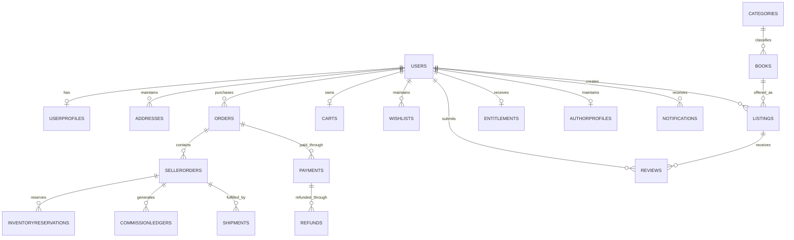

# BOOK BAZAR – DATABASE DESIGN DOCUMENT

**Document Version:** 1.0
**Project:** Book Bazar
**Database:** MongoDB
**ODM:** Mongoose
**Database Architecture:** Document-Oriented Database
**Status:** Initial Database Design Baseline

---

# 1. Introduction

## 1.1 Purpose

This document defines the database architecture and data management strategy of Book Bazar.

It specifies:

- MongoDB collections.
- Mongoose schema structures.
- Field definitions and data types.
- Document relationships.
- Validation rules.
- Database indexes.
- Data integrity requirements.
- Transaction management.
- Financial data management.
- Data retention considerations.

## 1.2 Database Objectives

The database must:

1. Support multiple user capabilities.
2. Maintain independent book catalogue and seller listing records.
3. Support multi-seller shopping and order processing.
4. Maintain accurate inventory.
5. Support secure payment records.
6. Maintain auditable commission transactions.
7. Enforce first-transaction entitlement rules.
8. Support shipment and delivery tracking.
9. Support future digital publishing.
10. Maintain data consistency during concurrent operations.

# 2. Database Technology

| Component              | Technology                        |
| ---------------------- | --------------------------------- |
| Primary Database       | MongoDB                           |
| ODM                    | Mongoose                          |
| Database GUI           | MongoDB Compass                   |
| Local Database         | Dockerized MongoDB                |
| Production Database    | MongoDB Atlas                     |
| Query Management       | Mongoose                          |
| Transaction Management | MongoDB Sessions and Transactions |

## 2.1 Database Naming

Database name:

`book_bazar`

Collection naming convention:

- users
- userprofiles
- addresses
- books
- categories
- listings
- carts
- wishlists
- orders
- sellerorders
- inventoryreservations
- payments
- refunds
- commissionledgers
- entitlements
- shipments
- reviews
- authorprofiles
- notifications
- otprecords
- refreshtokens
- auditlogs

Mongoose models will use PascalCase names, with explicit collection names where appropriate.

# 3. Database Architecture Overview

The database will contain the following major entities.

The diagram represents logical relationships. MongoDB will implement these using document references and selected embedded documents.

# 4. Collection Design

# 4.1 Users Collection

**Collection:** `users`

**Purpose:** Stores account credentials, account status and user capabilities.

| Field         | Data Type | Description                                     |
| ------------- | --------- | ----------------------------------------------- |
| _id           | ObjectId  | Unique user identifier                          |
| fullName      | String    | User's full name                                |
| email         | String    | Email address                                   |
| emailVerified | Boolean   | Email verification status                       |
| phone         | String    | Mobile number                                   |
| phoneVerified | Boolean   | Phone verification status                       |
| passwordHash  | String    | Hashed password                                 |
| capabilities  | Array     | Buyer, seller and author capabilities           |
| adminRole     | String    | Separately controlled administrative permission |
| accountStatus | String    | Active, suspended or pending verification       |
| createdAt     | Date      | Account creation timestamp                      |
| updatedAt     | Date      | Last modification timestamp                     |

### Important Rules

- Email addresses must be normalized.
- Unique email constraints must be enforced.
- Verified phone numbers must be unique where required.
- Passwords must never be stored in plaintext.
- Administrative permissions must not be self-assigned.
- Buyer, Seller and Author capabilities may coexist.

### Indexes

- Unique index on normalized email.
- Unique partial index on verified phone number.
- Index on account status.

# 4.2 UserProfiles Collection

**Collection:** `userprofiles`

**Purpose:** Stores additional profile information separately from authentication credentials.

| Field        | Data Type | Description                  |
| ------------ | --------- | ---------------------------- |
| _id          | ObjectId  | Profile identifier           |
| userId       | ObjectId  | Reference to Users           |
| profileImage | String    | Storage reference            |
| dateOfBirth  | Date      | Optional birth date          |
| gender       | String    | Optional profile information |
| bio          | String    | User description             |
| preferences  | Object    | Application preferences      |
| createdAt    | Date      | Creation timestamp           |
| updatedAt    | Date      | Modification timestamp       |

### Relationship

One user can have one profile.

### Indexes

- Unique index on userId.

# 4.3 Addresses Collection

**Collection:** `addresses`

**Purpose:** Stores user delivery addresses.

| Field         | Data Type | Description        |
| ------------- | --------- | ------------------ |
| _id           | ObjectId  | Address identifier |
| userId        | ObjectId  | User reference     |
| recipientName | String    | Recipient name     |
| phone         | String    | Contact number     |
| addressLine1  | String    | House/building     |
| addressLine2  | String    | Street/locality    |
| landmark      | String    | Nearby landmark    |
| city          | String    | City               |
| state         | String    | State              |
| postalCode    | String    | Postal code        |
| country       |           |                    |
