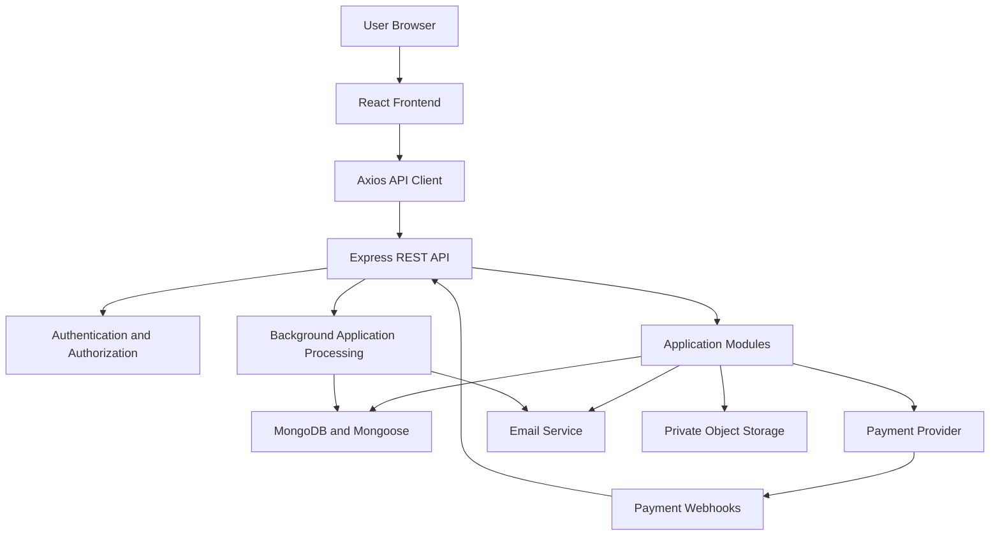
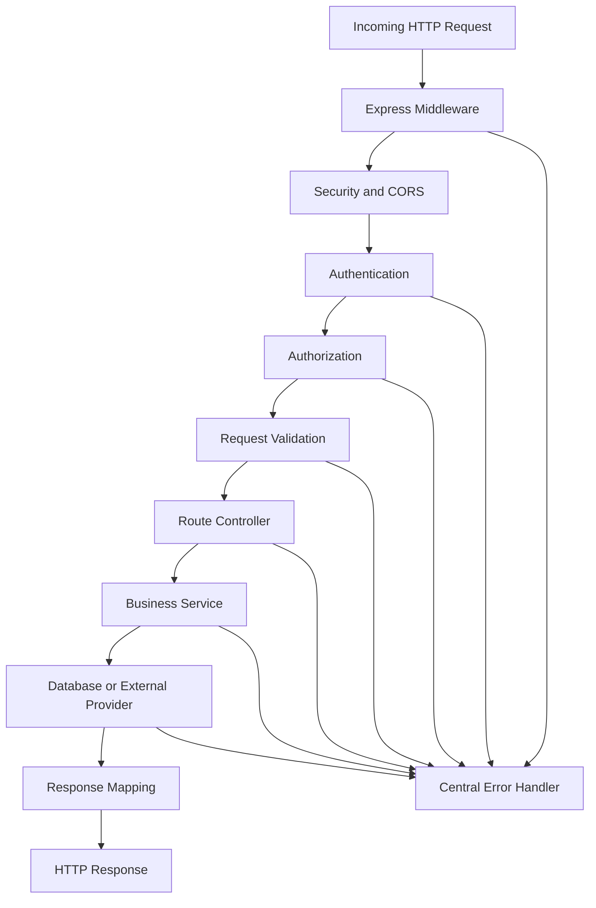

# BOOK BAZAR — TECHNICAL SPECIFICATION DOCUMENT

**Document Version:** 2.0
**Project:** Book Bazar
**Document Type:** Technical Specification
**Architecture:** Modular Full-Stack Monorepo
**Programming Language:** JavaScript ES6+
**Database:** MongoDB
**Status:** Approved Technical Baseline
**Last Updated:** 20 November 2026

---

# 1. Introduction

## 1.1 Purpose

This document defines the technical technologies, frameworks, dependencies, development standards, application architecture, integration methods, infrastructure requirements and engineering practices for Book Bazar.

It establishes a consistent implementation approach for frontend, backend, database, external integrations, testing and deployment.

## 1.2 Technical Objectives

- Develop a modular full-stack marketplace.
- Maintain clear frontend and backend separation.
- Use JavaScript throughout the application.
- Implement RESTful APIs.
- Use MongoDB as the primary database.
- Implement secure authentication and authorization.
- Support multiple capabilities on one user account.
- Maintain reliable inventory and financial operations.
- Integrate external payment and email services.
- Containerize application services using Docker.
- Maintain testable, maintainable and scalable architecture.

## 1.3 Engineering Principles

1. Preserve existing working functionality.
2. Separate presentation, business logic and data access.
3. Enforce business rules on the backend.
4. Validate all external inputs.
5. Maintain database consistency for critical operations.
6. Treat financial records as auditable and immutable.
7. Use environment-based configuration.
8. Avoid unnecessary dependencies and architectural complexity.
9. Prefer a modular monolith over premature microservices.
10. Test critical workflows before deployment.

---

# 2. Technology Stack

## 2.1 Frontend Technologies

| Technology        | Purpose                         |
| ----------------- | ------------------------------- |
| React 19          | Component-based UI              |
| JavaScript ES6+   | Frontend programming            |
| Vite              | Development server and bundler  |
| Tailwind CSS 4    | Utility-first styling           |
| Lucide React      | Application icons               |
| React Router      | Client-side navigation          |
| Axios             | HTTP communication              |
| TanStack Query    | Server-state management         |
| React Hook Form   | Form management                 |
| Zod               | Data validation                 |
| React Context API | Lightweight shared client state |

### Frontend Standards

1. Use functional React components.
2. Use React Hooks for component logic.
3. Maintain reusable UI components.
4. Separate pages from reusable components.
5. Separate API services from UI components.
6. Use centralized API configuration.
7. Implement protected application routes.
8. Implement capability-aware navigation.
9. Maintain responsive layouts.
10. Implement loading, error, success and empty states.
11. Use TanStack Query for server-state fetching and caching.
12. Use React Hook Form and Zod for validated forms.
13. Avoid unnecessary component duplication.
14. Avoid storing sensitive information in browser storage.

## 2.2 Backend Technologies

| Technology         | Purpose                    |
| ------------------ | -------------------------- |
| Node.js            | JavaScript runtime         |
| Express 5          | Backend framework          |
| JavaScript ES6+    | Backend programming        |
| Mongoose 8         | MongoDB object modelling   |
| MongoDB            | Primary database           |
| JWT                | Authentication tokens      |
| bcryptjs           | Password hashing           |
| Zod                | Request validation         |
| Multer             | Multipart file handling    |
| Helmet             | Security headers           |
| CORS               | Cross-origin configuration |
| Cookie Parser      | Cookie handling            |
| Nodemailer         | Email communication        |
| Express Rate Limit | Request rate limiting      |

### Backend Standards

1. Use modular Express architecture.
2. Separate routes, controllers and services.
3. Keep business logic inside service modules.
4. Use Mongoose models for database operations.
5. Validate external requests using Zod.
6. Implement centralized error handling.
7. Implement authentication middleware.
8. Implement capability and resource authorization middleware.
9. Use environment variables for configuration.
10. Return consistent API responses.
11. Avoid placing business logic directly inside route handlers.
12. Use structured logging without exposing secrets.
13. Implement rate limiting for sensitive endpoints.
14. Use idempotency for critical payment and transaction operations.

## 2.3 Database Technologies

| Technology           | Purpose                    |
| -------------------- | -------------------------- |
| MongoDB              | Primary database           |
| Mongoose             | Object Document Mapper     |
| MongoDB Compass      | Database visualization     |
| MongoDB Atlas        | Managed database hosting   |
| MongoDB Transactions | Multi-document consistency |

### Database Standards

- Use structured Mongoose schemas.
- Define appropriate indexes.
- Validate document fields.
- Maintain timestamps.
- Use references where appropriate.
- Use embedded documents where appropriate.
- Avoid unnecessary data duplication.
- Maintain data ownership.
- Use transactions for critical multi-document operations.
- Design collections according to actual access patterns.
- Store monetary amounts as integer paise.
- Maintain immutable financial transaction records.
- Apply appropriate retention and deletion rules.

MongoDB transactions require a replica-set-capable deployment. Development and production database environments must support the transaction operations required by the application.

## 2.4 Testing Technologies

| Technology            | Purpose                           |
| --------------------- | --------------------------------- |
| Vitest                | Unit and integration test runner  |
| Supertest             | Backend API testing               |
| React Testing Library | Frontend component testing        |
| Playwright            | End-to-end browser testing        |
| Postman               | API inspection and manual testing |

## 2.5 Infrastructure Technologies

| Technology                | Purpose                            |
| ------------------------- | ---------------------------------- |
| Docker                    | Application containerization       |
| Docker Compose            | Local service orchestration        |
| Nginx                     | Reverse proxy and frontend serving |
| Git                       | Version control                    |
| GitHub                    | Source code hosting                |
| AWS or compatible hosting | Production infrastructure          |

---

# 3. Application Architecture

## 3.1 Architecture Style

Book Bazar shall use a **Modular Monolithic Architecture**.

The frontend and backend remain separate applications within one repository. Backend business domains are organized into modules inside one deployable API application.

The initial release will not use microservices.

## 3.2 High-Level Architecture



## 3.3 Frontend Architecture

The frontend shall be responsible for:

- User interface rendering.
- Client-side navigation.
- Form interactions.
- Client-side input validation.
- API communication.
- Server-state management.
- Authentication state presentation.
- Capability-aware navigation.
- Loading and error presentation.
- Responsive layouts.

The frontend shall not be the authority for financial, inventory, commission, payout or authorization decisions.

## 3.4 Backend Architecture

The backend shall be responsible for:

- Authentication.
- Authorization.
- Input validation.
- Business logic.
- Database operations.
- Inventory reservation.
- Order creation.
- Payment verification.
- Commission calculation.
- Financial records.
- Seller fulfillment.
- Return and refund processing.
- Notifications.
- Administrative operations.
- Audit logging.

All important business rules must be enforced on the backend.

## 3.5 Data Layer

Mongoose shall provide the database access layer.

The data layer shall:

- Define schemas and relationships.
- Validate persisted data.
- Maintain indexes.
- Enforce ownership rules through service-level checks.
- Support atomic updates.
- Support transactions for critical workflows.
- Prevent unauthorized data access.

---

# 4. Repository and Workspace Structure

## 4.1 Existing Workspace Structure

The repository uses npm workspaces:

```text
Book-Bazar/
│
├── apps/
│   ├── web/
│   │   ├── src/
│   │   ├── public/
│   │   └── package.json
│   │
│   └── api/
│       ├── src/
│       └── package.json
│
├── docs/
│   ├── authentication/
│   ├── architecture/
│   ├── database/
│   └── api/
│
├── package.json
├── package-lock.json
├── .env
├── .env.example
├── .gitignore
└── README.md
```

The existing repository structure is the starting point. Any proposed module organization must be reconciled with existing source files before implementation. Existing working files must not be deleted or moved merely to match an illustrative structure.

## 4.2 Recommended Frontend Module Organization

```text
apps/web/src/
│
├── assets/
├── components/
│   ├── common/
│   ├── layout/
│   └── ui/
│
├── pages/
│   ├── public/
│   ├── buyer/
│   ├── seller/
│   ├── author/
│   └── admin/
│
├── features/
│   ├── authentication/
│   ├── catalogue/
│   ├── search/
│   ├── cart/
│   ├── wishlist/
│   ├── checkout/
│   ├── orders/
│   ├── payments/
│   ├── seller/
│   ├── author/
│   ├── reviews/
│   └── notifications/
│
├── services/
├── hooks/
├── context/
├── routes/
├── schemas/
├── utils/
└── main.jsx
```

This is a recommended organization, not an instruction to restructure existing files without inspection.

## 4.3 Recommended Backend Module Organization

```text
apps/api/src/
│
├── config/
├── models/
├── routes/
├── controllers/
├── services/
├── middleware/
├── validators/
├── utils/
├── modules/
│   ├── authentication/
│   ├── users/
│   ├── addresses/
│   ├── catalogue/
│   ├── categories/
│   ├── listings/
│   ├── inventory/
│   ├── search/
│   ├── cart/
│   ├── wishlist/
│   ├── checkout/
│   ├── orders/
│   ├── payments/
│   ├── commissions/
│   ├── fulfillment/
│   ├── returns/
│   ├── payouts/
│   ├── authors/
│   ├── reviews/
│   ├── notifications/
│   ├── support/
│   └── admin/
├── app.js
└── server.js
```

Module boundaries may evolve as the existing implementation is inspected. The objective is clear separation of responsibilities, not unnecessary folder duplication.

---

# 5. Frontend Technical Design

## 5.1 Component Architecture

Frontend components shall be organized into:

- Shared UI components.
- Layout components.
- Feature components.
- Page components.
- Form components.
- Data display components.

Shared components shall avoid embedding feature-specific business logic.

## 5.2 Routing

React Router shall manage client-side navigation.

Routes shall be categorized into:

- Public routes.
- Authenticated routes.
- Buyer routes.
- Seller routes.
- Author routes.
- Super Admin routes.

Route protection must consider authentication, active capabilities and account restrictions.

Backend authorization remains mandatory regardless of frontend route protection.

## 5.3 API Communication

Axios shall provide centralized HTTP communication.

The API client shall support:

- Base URL configuration.
- Authentication headers.
- Credential handling.
- Request and response interceptors where appropriate.
- Standardized error handling.
- Session refresh handling.
- Request cancellation where appropriate.

## 5.4 Server-State Management

TanStack Query shall manage:

- API data fetching.
- Caching.
- Cache invalidation.
- Loading states.
- Error states.
- Mutations.
- Refetching after relevant updates.

Sensitive transaction state must always be retrieved from the backend rather than trusted from stale client cache.

## 5.5 Form Management

React Hook Form and Zod shall be used for form state and client-side validation.

The backend must independently validate all submitted data.

---

# 6. Backend Technical Design

## 6.1 Request Lifecycle



## 6.2 Routes

Routes shall:

- Define HTTP endpoints.
- Apply appropriate middleware.
- Connect endpoints to controllers.
- Avoid complex business logic.

## 6.3 Controllers

Controllers shall:

- Receive validated requests.
- Extract authenticated user context.
- Invoke relevant services.
- Map service results into API responses.
- Avoid direct implementation of complex business rules.

## 6.4 Services

Services shall contain business logic.

Examples:

- Registration and authentication services.
- Seller verification services.
- Listing services.
- Inventory services.
- Checkout services.
- Payment services.
- Commission services.
- Order services.
- Refund services.
- Payout services.
- Notification services.

## 6.5 Models

Mongoose models shall define:

- Schema fields.
- Data types.
- Validation.
- References.
- Indexes.
- Timestamps.
- Required persistence constraints.

## 6.6 Middleware

Middleware shall handle:

- Authentication.
- Capability authorization.
- Resource ownership.
- Administrative authorization.
- Request validation.
- Rate limiting.
- Security headers.
- Error handling.
- Request correlation and logging.

---

# 7. API Communication Standards

## 7.1 API Style

Book Bazar shall use RESTful JSON APIs.

The initial API version prefix shall be:

`/api/v1`

## 7.2 HTTP Methods

| Method | Purpose                                        |
| ------ | ---------------------------------------------- |
| GET    | Retrieve resources                             |
| POST   | Create resources or initiate operations        |
| PUT    | Replace a resource where appropriate           |
| PATCH  | Partially update resources                     |
| DELETE | Delete or deactivate resources where permitted |

## 7.3 Response Format

Successful response:

```json
{
  "success": true,
  "message": "Request completed successfully",
  "data": {}
}
```

Error response:

```json
{
  "success": false,
  "error": {
    "code": "VALIDATION_ERROR",
    "message": "The submitted information is invalid",
    "details": []
  }
}
```

The exact response structure shall be consistent across API modules.

## 7.4 HTTP Status Codes

| Status | Meaning                          |
| ------ | -------------------------------- |
| 200    | OK                               |
| 201    | Created                          |
| 202    | Accepted for processing          |
| 204    | Successful with no response body |
| 400    | Bad Request                      |
| 401    | Unauthorized                     |
| 403    | Forbidden                        |
| 404    | Not Found                        |
| 409    | Conflict                         |
| 422    | Validation Error                 |
| 429    | Too Many Requests                |
| 500    | Internal Server Error            |
| 502    | External Provider Error          |
| 503    | Service Unavailable              |

## 7.5 API Validation

All external inputs must be validated before business processing.

Validation shall cover:

- Request body.
- Query parameters.
- Route parameters.
- Uploaded files.
- Identifiers.
- Monetary values.
- Quantities.
- Status transitions.
- Pagination limits.

---

# 8. Authentication and Authorization Design

## 8.1 Authentication

The application shall use:

- JWT-based access authentication.
- Refresh-token-based session renewal.
- Secure password hashing using bcryptjs.
- Email verification.
- Password reset tokens.
- Session management.
- Secure logout.

## 8.2 Token Handling

The intended session design shall:

- Keep access tokens short-lived.
- Store refresh tokens using secure HTTP-only cookies.
- Apply appropriate Secure and SameSite cookie settings.
- Rotate refresh tokens.
- Revoke sessions during logout and relevant security events.
- Avoid exposing refresh tokens to JavaScript.

Exact token lifetimes and cookie settings shall be configured through security policy and environment-specific configuration.

## 8.3 Capability Authorization

The system shall support:

- Buyer capability.
- Seller capability.
- Author capability.
- Multiple capabilities on one account.
- Separately provisioned Super Admin access.

Authorization must verify both the required capability and resource ownership where relevant.

## 8.4 Administrative Authentication

Super Admin access shall require:

- Dedicated administrative login.
- Securely provisioned credentials.
- Mandatory MFA for every login.
- Secure session management.
- Protected administrative endpoints.
- Auditing of sensitive operations.

Authentication-specific implementation details remain governed by the six documents under `docs/authentication/`.

---

# 9. Database and Data Integrity Design

## 9.1 Database Design Principles

- Use MongoDB as the primary database.
- Use Mongoose for schema and model management.
- Separate marketplace domains.
- Use appropriate references and embedded snapshots.
- Define unique and compound indexes where required.
- Maintain timestamps and status history.
- Protect ownership and authorization boundaries.
- Avoid uncontrolled duplication.
- Use transactions for critical multi-document operations.

Detailed collections and relationships are governed by `docs/database/database-design.md`.

## 9.2 Financial Data

All monetary values shall be stored as integer paise.

Financial calculations shall avoid floating-point arithmetic.

The application shall maintain separate records for:

- Payment attempts.
- Successful payments.
- Commission entries.
- Entitlement consumption.
- Seller earnings.
- Payouts.
- Refunds.
- Financial adjustments.

Completed financial records shall not be silently overwritten or deleted.

## 9.3 Inventory Consistency

Inventory operations shall:

- Use atomic database updates.
- Validate available quantity.
- Prevent negative stock.
- Prevent concurrent overselling.
- Maintain reservation records.
- Explicitly release expired reservations.
- Record inventory changes.

## 9.4 Transactional Operations

MongoDB transactions or equivalent carefully designed consistency mechanisms shall protect critical multi-document operations.

Examples include:

- Checkout and order creation.
- Inventory reservation.
- Payment confirmation.
- Commission ledger creation.
- Refund processing.
- Payout accounting.

External provider calls shall not be treated as part of a MongoDB transaction. The system must use durable operation states, idempotency and reconciliation to coordinate external side effects.

---

# 10. Payment Integration Design

## 10.1 Provider Selection

Cashfree Easy Split is the preferred candidate, not a finalized provider.

Selection is conditional on written verification of:

- Marketplace eligibility.
- UPI-only seller onboarding.
- Seller settlement requirements.
- Weekly deferred settlement.
- Pricing and processing charges.
- Multi-seller split support.
- Refund and adjustment capabilities.
- Webhook reliability.
- Reconciliation facilities.

No provider-specific assumption shall be hardcoded before selection.

## 10.2 Payment Flow

1. Backend validates checkout.
2. Backend creates the payment attempt.
3. Backend creates or requests the provider payment order.
4. Provider reference is persisted.
5. Frontend initiates the supported payment experience.
6. Provider processes the payment.
7. Backend receives trusted provider information.
8. Backend verifies payment status.
9. Backend processes the event idempotently.
10. Backend updates payment and order records.
11. Backend generates the receipt after verified success.

## 10.3 Payment Security

- Never trust frontend success callbacks alone.
- Verify provider webhook signatures.
- Validate provider transaction references.
- Implement idempotent processing.
- Handle duplicate and out-of-order events.
- Handle delayed and late-success events.
- Reconcile local records with provider records.
- Never store card numbers, CVV or UPI PIN.

## 10.4 Payment States

The payment state machine shall support:

- Initiated.
- Pending.
- Successful.
- Failed.
- Expired.
- Refund Initiated.
- Refunded.

Invalid transitions shall be rejected.

---

# 11. Inventory Reservation and Checkout Design

## 11.1 Reservation Policy

- No stock reservation in the cart.
- Reservation begins during checkout.
- Reservation duration is 15 minutes.
- Inventory updates must be atomic.
- Expired reservations must be explicitly released.
- Successful payment converts reserved stock into sold stock.
- Eligible cancellation restores inventory.

## 11.2 Expiration Processing

The application shall include an explicit mechanism for identifying and releasing expired reservations.

This may use a scheduled application worker or another controlled processing mechanism.

MongoDB TTL deletion alone is not sufficient because deleting a reservation document does not automatically restore the corresponding inventory.

## 11.3 Late Payment Success

If a payment succeeds after the reservation has expired:

1. Verify the provider payment.
2. Identify the expired reservation and order state.
3. Check whether inventory can still be fulfilled safely.
4. Apply the defined recovery path.
5. If fulfillment is not possible, initiate the appropriate refund or resolution.
6. Record all state transitions and financial references.

The system must not silently oversell inventory.

---

# 12. Order and Fulfillment Design

## 12.1 Parent Order

The parent order shall represent the complete buyer checkout.

It shall maintain:

- Buyer reference.
- Order identifier.
- Overall price snapshot.
- Payment reference.
- Delivery information snapshot.
- Overall order state.
- Creation and update timestamps.

## 12.2 Seller Orders

Each participating seller shall receive an independent seller order.

Seller orders shall maintain:

- Seller reference.
- Parent order reference.
- Purchased items.
- Quantity and price snapshots.
- Seller-specific shipping charges.
- Fulfillment status.
- Courier and tracking information.
- Dispatch evidence.
- Delivery information.

## 12.3 Status Separation

The following states must remain separate:

- Payment status.
- Parent order status.
- Seller fulfillment status.
- Shipment status.
- Refund status.
- Payout status.

A single status field must not represent all these independent processes.

## 12.4 Delivery Responsibility

The initial release shall use seller-managed delivery.

Sellers are responsible for:

- Packaging.
- Selecting the courier or delivery arrangement.
- Dispatching the order.
- Providing tracking information.
- Submitting dispatch evidence.
- Reporting delivery delays.

The platform manages status records, notifications, disputes and policy enforcement.

---

# 13. Commission and Financial Calculation Design

## 13.1 Commission Rule

Default commission:

**10% of net book selling price after seller-funded discounts.**

Exclude:

- Delivery charges.
- Separately collected taxes.

## 13.2 First Transaction Entitlement

The entitlement shall be maintained centrally and consumed by the first successful purchase or sale.

- First successful purchase: entitlement consumed; no buyer fee waiver.
- First eligible sale: commission waived for that sale if entitlement remains unused.
- Subsequent eligible sales: normal commission applies.

## 13.3 Calculation Requirements

- Use integer paise.
- Apply deterministic rounding rules.
- Persist calculation inputs and results.
- Maintain commission ledger entries.
- Avoid recalculating historical transactions using changed policies.
- Record adjustments separately.

---

# 14. Seller Earnings and Payout Design

## 14.1 Earnings Eligibility

Seller proceeds become eligible after:

1. Delivery confirmation.
2. Completion of the three-calendar-day return window.
3. Validation of disputes, refunds and chargebacks.
4. Removal of applicable payout holds.

## 14.2 Settlement

- Weekly automatic settlement is the target.
- No platform-defined minimum payout.
- UPI ID/VPA is the preferred payout destination.
- Provider capabilities must be verified.
- Payout status must be based on trusted provider information.

## 14.3 Payout Security

- Protect payout destination information.
- Re-verify changed payout details.
- Hold payouts until changed details are verified.
- Record provider payout references.
- Maintain immutable settlement history.

---

# 15. File and Media Storage Design

## 15.1 Upload Types

- Profile photographs.
- Book cover images.
- Seller listing photographs.
- Seller verification documents.
- Author evidence documents.
- Return and dispute evidence.

## 15.2 Upload Handling

Multer shall handle multipart file reception.

The application shall validate:

- File size.
- MIME type.
- File extension.
- Upload permissions.
- Associated entity ownership.

File validation must not rely exclusively on client-provided MIME types.

## 15.3 Storage Policy

- Public catalogue and listing images may use controlled public delivery.
- Verification documents must use private storage.
- Dispute evidence must use private storage.
- Sensitive documents must not be exposed through unrestricted URLs.
- Retention and deletion shall follow applicable policy.

The production object-storage provider remains to be finalized.

---

# 16. Email and Notification Integration

## 16.1 Email Service

Nodemailer shall provide email communication.

Development email configuration shall use the approved Gmail SMTP setup.

Production email infrastructure may change after deliverability and operational requirements are reviewed.

## 16.2 Email Events

The system shall support:

- Registration verification.
- Password reset.
- Security alerts.
- Order confirmation.
- Payment receipts.
- Dispatch updates.
- Delivery updates.
- Cancellation and refund updates.
- Seller verification updates.
- Author publication decisions.
- Payout notifications.
- Support and dispute updates.

## 16.3 Reliability

Email delivery shall be coordinated with application events.

Duplicate event processing must not produce duplicate transactional emails.

Email failures must be logged and recoverable where appropriate. A failed email delivery must not silently reverse a successfully completed payment or order.

---

# 17. Security Design

## 17.1 Authentication Security

- Secure password hashing.
- Short-lived access tokens.
- Refresh-token rotation.
- Session revocation.
- Email verification.
- Password reset token expiration.
- Mandatory administrative MFA.

## 17.2 API Security

- Helmet security headers.
- CORS allowlist configuration.
- Rate limiting.
- Request validation.
- Authentication middleware.
- Capability authorization.
- Resource ownership checks.
- Centralized error handling.
- Secure file upload validation.

## 17.3 Secrets Management

- Store secrets in environment variables or approved secret-management systems.
- Never commit `.env` files.
- Maintain `.env.example` with placeholder values only.
- Never log passwords, tokens, private keys or provider secrets.
- Rotate credentials if exposure is suspected.

## 17.4 Payment Security

- Verify provider signatures.
- Verify transaction references.
- Use idempotency.
- Reconcile payment status.
- Do not store card numbers, CVV or UPI PIN.
- Do not trust frontend payment status.

## 17.5 Administrative Security

- Separate administrative login.
- Mandatory MFA.
- Restricted administrative APIs.
- Audited sensitive actions.
- Secure recovery process.
- Capability-specific restrictions.

---

# 18. Logging, Error Handling and Monitoring

## 18.1 Application Logging

The backend shall record relevant operational events, including:

- Application startup and shutdown.
- Database connection status.
- API errors.
- Authentication failures.
- Payment processing events.
- Order state transitions.
- Inventory reservation failures.
- External provider failures.
- Administrative actions.

## 18.2 Logging Restrictions

Logs must not expose:

- Plaintext passwords.
- Authentication tokens.
- Refresh tokens.
- UPI PIN.
- Card details.
- Database credentials.
- Private document contents.
- Unnecessary personal information.

## 18.3 Error Handling

The backend shall use centralized error handling and consistent error response structures.

Internal stack traces and sensitive implementation details must not be returned to production clients.

## 18.4 Monitoring

Production deployment should monitor:

- API availability.
- Application errors.
- Database connectivity.
- Payment integration failures.
- Background processing failures.
- Email delivery failures.
- Resource utilization.

---

# 19. Testing Strategy

## 19.1 Unit Testing

Vitest shall test isolated business logic and utility functions.

Examples:

- Commission calculations.
- Entitlement consumption.
- Validation rules.
- Price calculations.
- Status transition rules.
- Inventory calculation logic.

## 19.2 Backend Integration Testing

Vitest and Supertest shall test:

- Authentication endpoints.
- Capability authorization.
- Catalogue endpoints.
- Listing operations.
- Cart and checkout.
- Inventory reservation.
- Orders.
- Payment webhook processing.
- Commission calculations.
- Returns and refunds.
- Administrative operations.

## 19.3 Frontend Testing

React Testing Library shall test:

- Component rendering.
- Form validation.
- Navigation behaviour.
- User interactions.
- Loading and error states.
- Capability-aware UI.

## 19.4 End-to-End Testing

Playwright shall test critical complete user journeys:

- Registration and login.
- Book discovery.
- Seller verification.
- Listing creation.
- Multi-seller checkout.
- Payment success and failure.
- Seller fulfillment.
- Returns and refunds.
- Author publication submission.
- Super Admin workflows.

## 19.5 Regression Testing

Existing working functionality must be tested after relevant changes.

No implementation shall be considered complete merely because the changed screen appears correct.

---

# 20. Performance and Scalability

## 20.1 API Performance

- Use pagination for large collections.
- Limit query results.
- Define appropriate indexes.
- Avoid unnecessary database calls.
- Avoid unbounded document population.
- Optimize frequently accessed queries.

## 20.2 Frontend Performance

- Reuse components.
- Avoid unnecessary rendering.
- Use appropriate data caching.
- Optimize image delivery.
- Use lazy loading where appropriate.
- Avoid unnecessarily large API payloads.

## 20.3 Scalability

The modular monolith shall support future expansion through clear module boundaries.

Microservices, Redis and additional infrastructure shall not be introduced without a demonstrated requirement and an approved architecture decision.

---

# 21. Deployment Architecture

## 21.1 Development Environment

The development environment shall support:

- React/Vite frontend.
- Express backend.
- MongoDB local or Atlas database.
- Environment-based configuration.
- Local email testing.
- Automated tests.

## 21.2 Containerization

Docker shall be used to package application services.

Docker Compose shall orchestrate local services where appropriate.

## 21.3 Production Architecture

The intended production deployment may contain:

1. Nginx reverse proxy.
2. React frontend build.
3. Node.js/Express API.
4. MongoDB Atlas or approved MongoDB hosting.
5. Private object storage.
6. External payment provider.
7. Email delivery service.

Final hosting and provider selections remain subject to cost, reliability, security and operational review.

## 21.4 Environment Configuration

Environment-specific configuration shall be maintained separately.

Typical configuration categories include:

- Application environment.
- API port.
- Frontend origin.
- MongoDB connection URI.
- JWT secrets.
- Cookie settings.
- Email SMTP settings.
- Payment provider credentials.
- Object-storage credentials.
- Logging configuration.

Actual secret values must never appear in documentation or source control.

---

# 22. Version Control and Development Workflow

## 22.1 Git

Git shall maintain source-code history.

All development shall preserve existing repository history.

Force-pushing or destructive history rewriting is not permitted unless explicitly reviewed and approved.

## 22.2 Branching

Development shall use controlled branches for changes.

Changes shall be reviewed and tested before merging into the primary branch.

## 22.3 Commit Practices

Commits should:

- Describe the actual change.
- Remain focused.
- Avoid unrelated file modifications.
- Exclude secrets and generated dependencies.
- Include relevant tests and documentation changes.

## 22.4 CI/CD

The CI pipeline shall validate:

- Dependency installation.
- Frontend build.
- Backend syntax/build checks.
- Automated tests.
- Relevant quality checks.

Deployment automation shall be configured separately and must not bypass required validation.

---

# 23. External Dependencies and Unresolved Technical Decisions

| Area                  | Current Decision                               | Pending Verification                                                 |
| --------------------- | ---------------------------------------------- | -------------------------------------------------------------------- |
| Payment gateway       | Cashfree Easy Split preferred candidate        | Marketplace eligibility, pricing, onboarding, settlement and refunds |
| Seller payouts        | UPI ID/VPA preferred                           | Provider support and verification                                    |
| Email                 | Gmail SMTP for development                     | Production email service                                             |
| Object storage        | Private object storage                         | Final provider and configuration                                     |
| Hosting               | AWS or compatible hosting                      | Final deployment provider                                            |
| Monitoring            | Operational logging required                   | Production monitoring solution                                       |
| Background processing | Explicit application-level processing required | Final worker/scheduling implementation                               |
| Tax and invoicing     | Compliance-first approach                      | CA/legal confirmation                                                |

Unresolved decisions must be explicitly tracked. No provider-dependent feature shall be implemented using assumed capabilities.

---

# 24. Technical Acceptance Criteria

The technical baseline shall be considered correctly implemented when:

1. Frontend and backend remain independently organized.
2. The application uses the approved JavaScript technology stack.
3. Existing npm workspaces remain functional.
4. Backend business logic is separated from route handlers.
5. API requests are validated.
6. Authentication and capability authorization are enforced.
7. MongoDB schemas and indexes support the approved workflows.
8. Critical multi-document operations preserve data consistency.
9. Inventory reservations prevent overselling.
10. Expired reservations are explicitly released.
11. Payment verification is backend-controlled.
12. Payment processing is idempotent.
13. Financial records are auditable and immutable.
14. File uploads follow public/private storage rules.
15. Sensitive information is protected.
16. Automated tests cover critical workflows.
17. Frontend and backend builds pass.
18. Docker-based deployment is reproducible.
19. Existing functionality remains operational.
20. Documentation accurately reflects implementation decisions.

---

# 25. Document Governance

| Field        | Value                          |
| ------------ | ------------------------------ |
| Document     | Technical Specification        |
| Project      | Book Bazar                     |
| Version      | 2.0                            |
| Status       | Approved Technical Baseline    |
| Owner        | Book Bazar Project Team        |
| Last Updated | 20 November 2026               |
| Next Review  | Before detailed implementation |

**End of Document**
