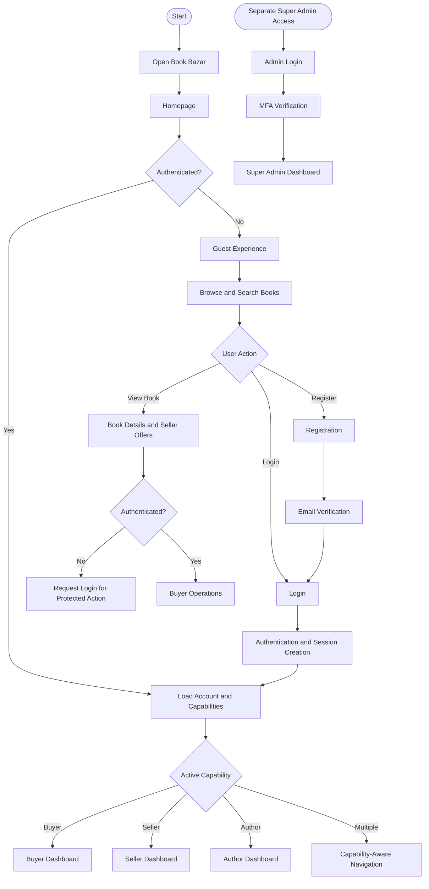
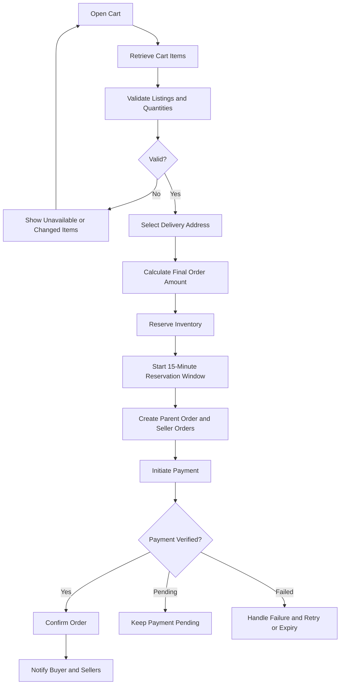
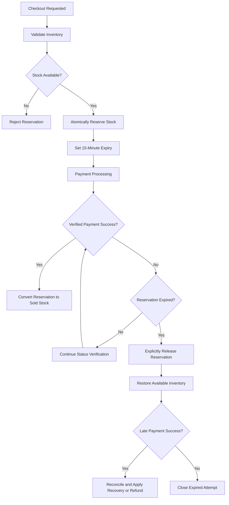

# BOOK BAZAR — USER FLOW DOCUMENT

**Document Version:** 2.0
**Project:** Book Bazar
**Document Type:** User Flow Specification
**Status:** Approved Workflow Baseline
**Last Updated:** 20 November 2026

---

# 1. Introduction

## 1.1 Purpose

This document describes how users interact with Book Bazar. It defines navigation paths, user actions, system responses, decision points, validation steps and workflow transitions for the major application modules.

It serves as a reference for frontend implementation, backend API development, business logic, database operations and end-to-end testing.

## 1.2 User Types and Capabilities

Book Bazar supports:

1. Guest User.
2. Registered Buyer.
3. Seller.
4. Author.
5. Super Admin.

Buyer, Seller and Author are capabilities that can coexist on one registered account. Buyer capability is assigned by default. Seller and Author capabilities can be activated later.

Super Admin access is separately provisioned and cannot be obtained through public registration.

## 1.3 General Workflow Principles

- Users may browse public marketplace content without authentication.
- Authentication is required for account-specific operations.
- Backend authorization is mandatory for protected actions.
- All marketplace data must come from persistent database records.
- Financial operations must be verified by trusted backend mechanisms.
- Order and seller fulfillment statuses are maintained separately.
- Important user actions must provide clear success, error and pending feedback.

---

# 2. Overall Application Flow

---

# 3. Guest User Flow

## 3.1 Homepage Access

1. User opens Book Bazar.
2. System loads the public homepage.
3. System retrieves configured homepage content.
4. User sees navigation, search, categories and available books.
5. User can browse public marketplace content.
6. User can open book details and seller offers.

## 3.2 Book Discovery

1. User opens Explore Books.
2. System retrieves catalogue books with active seller offers.
3. User enters a search keyword.
4. System searches supported fields.
5. User applies filters or sorting.
6. System updates the result list.
7. User selects a book.
8. System opens the book detail page.
9. System displays available seller offers, conditions, prices and shipping information.

## 3.3 Guest Registration

1. User selects Sign Up.
2. System displays the registration form.
3. User enters the required registration information.
4. Frontend validates the submitted fields.
5. Registration request is sent to the backend.
6. Backend validates and normalizes the data.
7. Backend checks whether the account already exists.
8. Backend securely hashes the password.
9. Backend creates the user account with Buyer capability by default.
10. Backend initiates email verification.
11. User receives a verification email.
12. User opens the verification link.
13. Backend validates the verification token.
14. Email address is marked as verified.
15. User can log in.

Registration does not ask the user to select Buyer, Seller or Author.

## 3.4 Guest Login

1. User selects Login.
2. System displays the login form.
3. User enters registered email and password.
4. Frontend validates the form.
5. Login request is sent to the backend.
6. Backend verifies the account and password.
7. Backend checks account status and authentication policy.
8. Backend creates an authenticated session.
9. Access token is issued.
10. Refresh token is issued through a secure HTTP-only cookie.
11. User is redirected to the appropriate authenticated application page.

## 3.5 Guest Access Restrictions

If a guest attempts to:

- Add a book to the wishlist.
- Add an item to the cart where authentication is required.
- Place an order.
- Submit a review.
- Access private account information.

The system shall request authentication before continuing with the protected action.

---

# 4. Authentication and Session Flow

Authentication-specific workflows are documented in `docs/authentication/user-flow.md`. The following summarizes their application-wide integration.

## 4.1 Email Verification

1. User receives a verification email.
2. User opens the verification link.
3. Frontend submits the verification token.
4. Backend validates the token and its expiry.
5. Backend marks the email as verified.
6. Verification token is invalidated.
7. User receives confirmation.

## 4.2 Refresh Session

1. Access token expires.
2. Frontend requests a new access token.
3. Browser sends the refresh cookie.
4. Backend validates the refresh token.
5. Backend checks the corresponding session.
6. Backend rotates the refresh token.
7. Previous refresh token becomes invalid.
8. New access token and refresh cookie are issued.

If validation fails, the session is rejected and the user must authenticate again.

## 4.3 Logout

1. User selects Logout.
2. Frontend sends the logout request.
3. Backend revokes the current session.
4. Refresh cookie is cleared.
5. Frontend clears authenticated user state.
6. User is redirected to the homepage or login page.

## 4.4 Forgot Password

1. User opens Forgot Password.
2. User enters their registered email address.
3. Backend generates a secure single-use reset token.
4. Backend stores the token hash.
5. Password reset email is sent.
6. User opens the reset link.
7. User enters and confirms a new password.
8. Backend validates the token and expiry.
9. Password is securely updated.
10. Reset token is invalidated.
11. Existing sessions are revoked.
12. User logs in with the new password.

## 4.5 Authorization

1. User requests a protected resource.
2. Frontend sends the access token.
3. Backend validates authentication.
4. Backend identifies the user.
5. Backend checks required capability and permission.
6. Backend checks resource ownership where applicable.
7. Request is permitted or rejected.
8. Frontend handles the response.

---

# 5. Buyer User Flow

## 5.1 Buyer Dashboard

1. Buyer logs in.
2. Backend authenticates the user.
3. System retrieves the user's active capabilities.
4. System loads the buyer interface.
5. Buyer can access:
   - Homepage.
   - Explore Books.
   - Categories.
   - Wishlist.
   - Shopping Cart.
   - My Orders.
   - Profile.
   - Account Settings.

If the same account also has Seller or Author capability, the interface provides access to those areas according to permissions.

## 5.2 Book Browsing

1. Buyer opens Explore Books.
2. System retrieves available catalogue books.
3. Buyer searches by title, author, ISBN, publisher or keyword.
4. Buyer applies available filters.
5. Buyer selects sorting preferences.
6. System retrieves matching results.
7. Buyer opens a book.
8. System displays book information and available seller offers.
9. Buyer compares condition, price, seller and shipping charges.
10. Buyer selects a suitable offer.

## 5.3 Add to Wishlist

1. Buyer opens a book detail page.
2. Buyer selects Add to Wishlist.
3. Frontend sends the request.
4. Backend validates authentication.
5. Backend checks whether the book is already saved.
6. Backend creates the wishlist entry if necessary.
7. System displays confirmation.
8. Wishlist is updated.

## 5.4 Add to Cart

1. Buyer selects a seller offer.
2. Buyer selects the desired quantity.
3. Buyer selects Add to Cart.
4. Backend validates the listing.
5. Backend checks seller and listing status.
6. Backend checks current stock.
7. System adds or updates the cart item.
8. System displays the updated cart.

Adding an item to the cart does not reserve inventory.

## 5.5 Shopping Cart Review

1. Buyer opens the cart.
2. System retrieves cart items.
3. System groups items by seller.
4. Buyer reviews book details and quantities.
5. Buyer updates or removes items if required.
6. System validates current availability where applicable.
7. System calculates estimated book subtotal and seller-wise shipping charges.
8. System displays applicable fees and taxes.
9. Buyer selects Proceed to Checkout.

## 5.6 Checkout Flow

Detailed steps:

1. Buyer selects Proceed to Checkout.
2. Backend retrieves the latest cart information.
3. Backend revalidates listings, seller eligibility, prices and stock.
4. System identifies unavailable or changed items.
5. Buyer selects an existing delivery address or adds a new one.
6. System calculates seller-wise shipping charges.
7. System calculates the final payable amount.
8. System displays the complete order summary.
9. Buyer reviews and confirms checkout.
10. Backend atomically reserves eligible inventory.
11. A 15-minute reservation window begins.
12. Backend creates one parent order and separate seller orders.
13. Backend creates a payment attempt.
14. System initiates payment through the configured provider.

If inventory reservation fails, checkout must not proceed using unavailable stock.

## 5.7 Payment Success Flow

1. Buyer completes the payment process.
2. Payment provider processes the transaction.
3. Provider sends a trusted response or webhook.
4. Backend verifies payment status.
5. Backend validates provider references and event authenticity.
6. Backend processes the payment event idempotently.
7. Payment record is updated to successful.
8. Parent order is confirmed.
9. Applicable seller orders are confirmed.
10. Inventory reservation is converted into a completed stock deduction.
11. System generates a payment receipt.
12. Buyer receives order confirmation and payment receipt.
13. Sellers receive their respective order notifications.
14. Buyer can view the order in My Orders.

## 5.8 Payment Pending Flow

1. Payment provider returns a pending or unconfirmed state.
2. Backend records the pending payment state.
3. Order remains unconfirmed for fulfillment.
4. Buyer sees a pending payment message.
5. Backend continues trusted status verification or reconciliation.
6. If payment succeeds, the success workflow continues.
7. If payment fails or expires, the failure workflow applies.

The frontend must not display payment success based only on a redirect or client-side callback.

## 5.9 Payment Failure and Retry Flow

1. Payment attempt fails or expires.
2. Backend records the failure or expiry state.
3. Buyer receives an appropriate status message.
4. Buyer may retry payment where permitted.
5. Backend creates or reuses an appropriate idempotent payment attempt.
6. Backend verifies any late provider success before changing transaction state.
7. If the reservation expires, the backend releases inventory.
8. Expired inventory reservations are explicitly processed.
9. If a late payment success arrives after expiry, the backend applies the defined recovery, reconciliation and refund handling.
10. No duplicate successful order or financial record is created.

## 5.10 Order History

1. Buyer opens My Orders.
2. System retrieves the buyer's parent orders.
3. Buyer selects an order.
4. System displays the overall order information.
5. Buyer views individual seller orders.
6. Buyer can inspect payment, fulfillment and shipment statuses.
7. Buyer can access receipts, eligible cancellation or return actions and dispute information.

---

# 6. Seller User Flow

## 6.1 Activate Seller Capability

1. Registered user opens account capabilities.
2. User selects Activate Seller.
3. System displays seller information requirements.
4. User selects Individual or Business seller type.
5. User submits the required information.
6. Backend creates or updates the seller capability record.
7. Seller verification workflow begins.
8. Seller gains access to the seller dashboard.
9. Seller may prepare draft listings while verification is pending.

## 6.2 Seller Verification

1. Seller opens Verification.
2. System displays the applicable verification requirements.
3. Seller submits identity or business information.
4. Seller uploads required documents.
5. Backend validates the submission.
6. Application is submitted for Super Admin review.
7. Super Admin reviews the application.
8. Super Admin selects a decision:
   - Approve.
   - Reject with reason.
   - Request additional information.
9. System records the decision.
10. Seller receives a notification.
11. If additional information is requested, seller submits the required details.
12. The application returns to review.
13. Public listing is enabled only after approval.

## 6.3 Create Seller Listing

1. Seller opens Seller Dashboard.
2. Seller selects Create Listing.
3. System displays the catalogue search.
4. Seller searches for the relevant book.
5. If the book exists, seller selects the catalogue entry.
6. If it does not exist, seller submits a new catalogue entry for the applicable review process.
7. Seller enters condition.
8. Seller enters fixed price and quantity.
9. Seller uploads required photographs.
10. Seller describes defects or missing pages where applicable.
11. Seller enters shipping and dispatch information.
12. Backend validates listing data.
13. Listing is saved as a draft or submitted for publication according to seller verification status.
14. Once all required approvals are satisfied, the listing becomes publicly available.

## 6.4 Manage Listings

1. Seller opens My Listings.
2. System retrieves the seller's listings.
3. Seller selects a listing.
4. Seller may update permitted information, price or quantity.
5. Seller may deactivate the listing.
6. Backend validates the requested change.
7. Updated listing information is saved.
8. Marketplace results reflect the new active listing state.

## 6.5 Receive and Process Orders

1. Buyer completes a successful payment.
2. Backend confirms the order.
3. System creates or updates the corresponding seller order.
4. Seller receives an order notification.
5. Seller opens Seller Orders.
6. Seller reviews items, quantities and delivery details.
7. Seller prepares the items for dispatch.
8. Seller packs the books.
9. Seller arranges delivery through the selected courier or delivery method.
10. Seller enters courier and tracking information where applicable.
11. Seller uploads dispatch evidence.
12. Seller marks the order as dispatched.
13. System updates the seller fulfillment status.
14. Buyer receives a dispatch notification.
15. Seller order progresses through applicable shipment states.
16. Delivery is confirmed.
17. System records delivery information.

## 6.6 Late Dispatch

1. System detects that the dispatch deadline is approaching or has passed.
2. Seller receives a reminder or overdue notification.
3. Seller reports a delay and provides a reason where applicable.
4. System records the delay.
5. Buyer is notified where appropriate.
6. Escalation and proportionate enforcement are applied according to configured policy.
7. Super Admin can review repeated or serious violations.

The dispatch deadline is three business days after confirmed payment.

## 6.7 Seller Earnings and Payouts

1. Seller opens Earnings.
2. System retrieves completed seller transactions.
3. System calculates book selling price, discounts, commission and adjustments.
4. System displays pending and eligible earnings.
5. System checks delivery confirmation.
6. System checks completion of the three-calendar-day return window.
7. System checks disputes, refunds, chargebacks and payout holds.
8. Eligible proceeds enter the payout process.
9. Weekly settlement is initiated through the supported provider.
10. Backend records provider payout references and status.
11. Seller receives payout status notification.
12. Seller can view payout history.

## 6.8 Manage Payout Destination

1. Seller opens Payout Settings.
2. Seller enters the preferred UPI ID/VPA.
3. Backend validates the submitted information according to provider requirements.
4. Required verification is initiated.
5. Seller receives verification status.
6. If payout details change, the new destination must be re-verified.
7. Payouts remain held until the changed destination is verified.

UPI-only settlement remains conditional on payment-provider support.

---

# 7. Author User Flow

## 7.1 Activate Author Capability

1. Registered user opens account capabilities.
2. User selects Activate Author.
3. System displays author capability information.
4. User confirms activation.
5. Backend activates Author capability.
6. Author Dashboard becomes accessible.

## 7.2 Submit a Publication

1. Author opens Author Dashboard.
2. Author selects Submit Publication.
3. System displays publication information fields.
4. Author enters book and authorship information.
5. Author provides an authorship and ownership declaration.
6. Author uploads supporting evidence.
7. Author submits the publication.
8. Backend validates required information.
9. Publication submission is created.
10. Status becomes Pending Review.

## 7.3 Publication Review

1. Super Admin opens Publication Review.
2. System displays pending submissions.
3. Super Admin opens a submission.
4. Super Admin reviews publication information and evidence.
5. Super Admin evaluates ownership, copyright, plagiarism, legality and policy compliance.
6. Super Admin selects a decision:
   - Approve.
   - Reject.
   - Request additional documentation.
7. System records the decision and reason.
8. Author receives a notification.
9. If additional documents are requested, author submits them.
10. Submission returns to review.

## 7.4 Approved Publication

1. Publication receives Approved status.
2. System creates or activates the public author profile after the first approved publication.
3. Author can manage optional biography, photograph and genres.
4. Approved publication appears on the public author profile.
5. Author can view publication status and profile information.

Authors are responsible for arranging and funding physical printing. Book Bazar does not provide printing or financing.

---

# 8. Reviews and Ratings User Flow

## 8.1 Review Eligibility

1. Buyer opens a completed order.
2. System checks whether the purchase was successful.
3. System checks whether delivery is confirmed.
4. System checks whether the buyer is eligible to review the book or seller.
5. If eligible, the review option is displayed.

## 8.2 Submit Review

1. Buyer selects Write Review.
2. Buyer selects a one-to-five-star rating.
3. Buyer optionally enters written feedback.
4. Buyer optionally uploads photographs.
5. Frontend validates the review.
6. Backend validates eligibility.
7. Review is saved.
8. System updates the relevant rating calculations.
9. Buyer receives confirmation.

## 8.3 Edit or Delete Review

1. Buyer opens their submitted review.
2. Buyer selects Edit or Delete.
3. Backend checks ownership and applicable time restrictions.
4. Edit is permitted within three calendar days.
5. Delete is permitted for the review owner.
6. System updates review and rating information.

## 8.4 Report Review

1. User selects Report Review.
2. User selects a reason.
3. Report is submitted.
4. Super Admin reviews the report.
5. Super Admin records a moderation decision.
6. The review is retained or moderated according to policy.
7. Relevant audit information is maintained.

---

# 9. Returns, Cancellations and Refunds User Flow

## 9.1 Cancellation Before Dispatch

1. Buyer opens My Orders.
2. Buyer selects the relevant seller order.
3. Buyer selects Request Cancellation.
4. Backend checks whether dispatch has occurred.
5. Buyer provides a cancellation reason.
6. System submits the request.
7. Seller or platform processes the request according to policy.
8. If approved, seller order is cancelled.
9. Applicable inventory is released.
10. Eligible refund is initiated.
11. Buyer receives a status update.

## 9.2 Seller Non-Dispatch

1. System detects that a seller has failed to dispatch within the applicable deadline.
2. Reminder and escalation procedures are applied.
3. Buyer may be notified of the delay.
4. Cancellation eligibility is evaluated.
5. If cancellation is approved, the seller order is cancelled.
6. Inventory and financial records are adjusted appropriately.
7. Eligible refund is initiated.
8. System records the outcome.

## 9.3 Return Request

1. Buyer opens a delivered seller order.
2. Buyer selects Request Return.
3. Backend checks delivery date.
4. Backend verifies that the request falls within the three-calendar-day return window.
5. System displays eligible return reasons.
6. Buyer selects the reason.
7. Buyer provides an explanation.
8. Buyer uploads supporting evidence.
9. Return request is submitted.
10. Seller receives the relevant notification.
11. Seller may provide a response.
12. Super Admin reviews the evidence and applicable policy.
13. A decision is recorded.
14. Buyer and seller are notified.

## 9.4 Refund

1. Return or cancellation is approved.
2. Backend validates the refundable amount.
3. Refund request is submitted to the payment provider.
4. Provider returns a refund reference or pending status.
5. Backend records the refund attempt.
6. Provider confirmation is verified.
7. Refund record is updated.
8. Buyer receives a refund status notification.
9. Original payment and receipt records remain unchanged.
10. Refund is maintained as a separate financial record.

Applicable Indian consumer rights and statutory obligations override platform policy.

---

# 10. Support and Dispute User Flow

## 10.1 Create Support Ticket

1. User opens Support.
2. User selects an issue category.
3. User enters the issue description.
4. User links an order where applicable.
5. User attaches supporting evidence where required.
6. User submits the ticket.
7. System creates a support record.
8. User receives confirmation and ticket reference.

## 10.2 Dispute Resolution

1. User opens the relevant dispute.
2. System displays current dispute status.
3. Buyer and seller submit relevant information where applicable.
4. Super Admin reviews the case.
5. Super Admin examines order records, evidence and communication.
6. Super Admin records a decision and reason.
7. Applicable refund, adjustment or other resolution is initiated.
8. Both parties receive the decision notification.
9. Dispute history is preserved.

## 10.3 Grievance Submission

1. User opens the grievance/contact mechanism.
2. User enters complaint details.
3. User submits the grievance.
4. System records the submission.
5. Authorized personnel review it.
6. Resolution and communication are recorded.
7. User receives an appropriate response.

Response targets must comply with applicable statutory requirements.

---

# 11. Super Admin User Flow

## 11.1 Super Admin Login

1. Super Admin opens the dedicated administrative login page.
2. Super Admin enters credentials.
3. Backend verifies the credentials.
4. System initiates mandatory MFA verification.
5. Super Admin completes MFA.
6. Backend verifies the MFA response.
7. Administrative session is created.
8. Super Admin is redirected to the dashboard.

Ordinary registration cannot create or assign Super Admin access.

## 11.2 Dashboard Overview

1. Super Admin opens the dashboard.
2. System retrieves database-backed metrics.
3. Dashboard displays marketplace, financial, operational and publishing summaries.
4. Super Admin selects a reporting period.
5. System refreshes relevant analytics.
6. Super Admin can open detailed reports and records.

## 11.3 User and Capability Management

1. Super Admin opens User Management.
2. Super Admin searches for a user.
3. System displays account information and active capabilities.
4. Super Admin reviews relevant activity.
5. Super Admin selects a capability-specific restriction or full suspension where justified.
6. Super Admin enters a reason and applicable policy reference.
7. Backend applies the restriction.
8. System records the action in the audit log.
9. User receives the applicable notification.

## 11.4 Seller Verification Review

1. Super Admin opens Seller Verification.
2. System displays pending applications.
3. Super Admin selects an application.
4. Super Admin reviews seller information and submitted documents.
5. Super Admin approves, rejects or requests additional information.
6. System records the decision and reason.
7. Seller receives a notification.
8. Seller listing permissions are updated according to the decision.

## 11.5 Marketplace and Listing Management

1. Super Admin opens Marketplace Management.
2. Super Admin searches catalogue entries or listings.
3. Super Admin reviews reported or policy-violating content.
4. Super Admin selects the appropriate moderation action.
5. System records the action and reason.
6. Marketplace visibility is updated where applicable.

## 11.6 Financial Management

1. Super Admin opens Financial Management.
2. System retrieves payment, commission, earnings and payout records.
3. Super Admin selects a transaction or payout.
4. System displays relevant references and history.
5. Super Admin may initiate an eligible refund or apply/release a payout hold.
6. Super Admin enters the required reason.
7. Backend validates the action and eligibility.
8. Financial adjustment or provider request is created where applicable.
9. Audit history is recorded.
10. The original completed financial record remains immutable.

Super Admin cannot manually fabricate payment or payout success.

## 11.7 Policy Configuration

1. Super Admin opens Platform Settings.
2. Super Admin selects a configurable policy.
3. System displays the current value and applicable constraints.
4. Super Admin enters the proposed new value.
5. Backend validates the configuration.
6. Super Admin confirms the change.
7. System records the effective date.
8. Configuration becomes effective according to its defined scope.
9. Audit history is maintained.

Policy changes must not retroactively modify completed transactions.

## 11.8 Appeals

1. User opens an enforcement notification.
2. User selects Submit Appeal where eligible.
3. User enters an explanation.
4. User attaches supporting evidence.
5. Appeal is submitted.
6. Super Admin reviews the original action and new evidence.
7. Super Admin records an appeal decision and reason.
8. User receives the outcome.
9. Rejected appeals may be resubmitted only when new evidence is provided.

---

# 12. Account Deletion and Privacy Request Flow

1. User opens Account Settings.
2. User selects Request Account Deletion.
3. System explains the consequences and retention obligations.
4. User confirms the request.
5. Backend verifies the requesting user.
6. System checks outstanding orders, payments, disputes and payouts.
7. System checks applicable legal retention requirements.
8. Request is processed according to the applicable policy.
9. Personal information is deleted or anonymized where legally permitted.
10. Required records are retained with appropriate access restrictions.
11. User receives the request status.
12. Audit history is maintained.

---

# 13. Notification Flow

## 13.1 Transactional Notifications

1. A relevant application event occurs.
2. Backend validates and records the event.
3. Notification service identifies relevant recipients.
4. User notification preferences and mandatory notification rules are evaluated.
5. In-app notification is created.
6. Email notification is sent where applicable.
7. Delivery status is recorded where supported.
8. Duplicate event processing does not create duplicate notifications.

## 13.2 Optional Notifications

1. User opens Notification Settings.
2. System displays optional notification categories.
3. User enables or disables a category.
4. Backend saves the preference.
5. Future optional notifications follow the saved preference.

Essential transactional and security notifications remain enabled where required.

---

# 14. Inventory Expiration and Recovery Flow

The application must explicitly process expired reservations. Removing expired reservation documents alone must never be treated as proof that inventory has been restored.

---

# 15. Order and Shipment Status Flow

## 15.1 Parent Order

The parent order represents the buyer's overall checkout.

Possible lifecycle states include:

- Pending Payment.
- Confirmed.
- Partially Fulfilled.
- Completed.
- Cancelled.
- Disputed.

## 15.2 Seller Order

Each seller order has its own fulfillment lifecycle.

Possible states include:

- Pending Confirmation.
- Processing.
- Packed.
- Dispatched.
- In Transit.
- Delivered.
- Cancellation Requested.
- Cancelled.
- Return Requested.
- Disputed.

Actual status transitions must be validated by backend business rules. Payment status and fulfillment status must not be merged into one field.

---

# 16. Error and Exception Handling

The system shall provide appropriate handling for:

- Invalid registration data.
- Duplicate account registration.
- Email verification failure.
- Invalid credentials.
- Expired authentication sessions.
- Unauthorized capability access.
- Inactive or unavailable listings.
- Insufficient inventory.
- Concurrent inventory reservation conflicts.
- Price changes during checkout.
- Payment failures.
- Payment pending states.
- Duplicate payment webhooks.
- Late payment success.
- Expired inventory reservations.
- Invalid delivery information.
- Seller dispatch delays.
- Return requests outside the eligible window.
- Refund provider failures.
- Upload validation failures.
- Email delivery failures.
- Database or service failures.

Errors must be recorded appropriately without exposing passwords, tokens, payment secrets or private personal information.

---

# 17. Cross-Module Workflow Dependencies

| Workflow              | Required Modules                                   |
| --------------------- | -------------------------------------------------- |
| Registration          | Authentication, database, email                    |
| Capability activation | Authentication, authorization                      |
| Seller verification   | Seller management, file storage, admin             |
| Book discovery        | Catalogue, listings, search                        |
| Wishlist              | Authentication, catalogue                          |
| Cart                  | Authentication, listings, inventory                |
| Checkout              | Cart, addresses, inventory, orders                 |
| Payment               | Checkout, payment provider, webhooks               |
| Commission            | Orders, payments, entitlement ledger               |
| Seller fulfillment    | Seller orders, inventory, tracking                 |
| Returns               | Orders, delivery, disputes, payments               |
| Payouts               | Earnings, commission, payment provider             |
| Receipts              | Payment verification, PDF generation, email        |
| Author publishing     | Author capability, file storage, admin             |
| Reviews               | Orders, delivery, ratings                          |
| Notifications         | Application events, email                          |
| Analytics             | Marketplace, orders, financial records             |
| Appeals               | Enforcement, evidence, admin                       |
| Account deletion      | Authentication, orders, financial records, privacy |

---

# 18. Workflow Acceptance Criteria

The user flows shall be considered correctly implemented when:

1. Guest browsing works without authentication.
2. Registration assigns Buyer capability by default.
3. Email verification follows the documented authentication flow.
4. A single account can have multiple marketplace capabilities.
5. Seller public listing is blocked until verification approval.
6. Author submissions follow the publication review workflow.
7. Buyers can browse real catalogue books and seller offers.
8. Cart and checkout validate current prices and inventory.
9. Checkout reserves inventory for 15 minutes.
10. Expired inventory reservations are explicitly released.
11. Multi-seller checkout creates one parent order and separate seller orders.
12. Payment success is based on trusted backend verification.
13. Payment retries and webhook reprocessing are idempotent.
14. Seller commission and entitlement follow approved rules.
15. Sellers manage their own dispatch and tracking.
16. Buyer returns and cancellations follow eligibility rules.
17. Seller payouts follow the approved eligibility and settlement rules.
18. Reviews are restricted to eligible verified purchasers.
19. Super Admin access requires MFA.
20. Financial and administrative actions are auditable.
21. Privacy and account deletion workflows preserve legally required records.
22. Existing authentication functionality remains intact.

---

# 19. Document Governance

| Field        | Value                                  |
| ------------ | -------------------------------------- |
| Document     | User Flow Specification                |
| Project      | Book Bazar                             |
| Version      | 2.0                                    |
| Status       | Approved Workflow Baseline             |
| Owner        | Book Bazar Project Team                |
| Last Updated | 20 November 2026                       |
| Next Review  | Before detailed feature implementation |

**End of Document**
