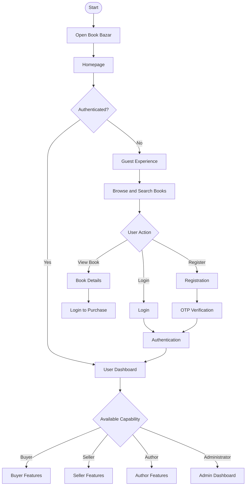

# BOOK BAZAR – USER FLOW DOCUMENT

**Document Version:** 1.0
**Project:** Book Bazar
**Document Type:** User Flow Specification
**Status:** Initial Workflow Baseline

---

# 1. Introduction

## 1.1 Purpose

This document defines how different users interact with the Book Bazar application.

It describes navigation paths, user actions, system responses, decision points and workflow transitions for all major application modules.

## 1.2 User Types

The application supports the following user types:

1. Guest User
2. Registered Buyer
3. Seller
4. Author
5. Administrator

A registered account can have multiple capabilities, including Buyer, Seller and Author.

Administrator access is separately authorized.

# 2. Overall Application Flow

# 3. Guest User Flow

## 3.1 Homepage Access

1. User opens Book Bazar.
2. System displays the homepage.
3. User can view navigation, featured books and categories.
4. User can access the search functionality.
5. User can browse publicly available book listings.

## 3.2 Book Discovery

1. User selects Explore Books.
2. System displays the catalogue.
3. User enters a search keyword.
4. System retrieves matching books.
5. User applies filters or sorting.
6. User selects a book.
7. System opens the book details page.

## 3.3 Guest Registration

1. User selects Sign Up.
2. System displays the registration form.
3. User enters personal information.
4. User enters email and mobile number.
5. User creates a password.
6. System validates submitted information.
7. System checks for existing accounts.
8. System creates a pending verification account.
9. System sends the configured OTP.
10. User enters the OTP.
11. System verifies the OTP.
12. Account becomes verified.
13. User is redirected to the authenticated application.

## 3.4 Guest Login

1. User selects Login.
2. System displays the login form.
3. User enters email/mobile and password.
4. Backend validates credentials.
5. System issues an authenticated session.
6. User is redirected to the appropriate application page.

# 4. Buyer User Flow

## 4.1 Buyer Dashboard

1. Buyer logs in.
2. System loads the buyer interface.
3. Buyer accesses:
   - Homepage
   - Explore Books
   - Categories
   - Wishlist
   - Shopping Cart
   - My Orders
   - Profile
   - Account Settings

## 4.2 Book Browsing

1. Buyer opens Explore Books.
2. System displays available listings.
3. Buyer searches by title, author or ISBN.
4. Buyer applies category, price or condition filters.
5. Buyer selects a book.
6. System displays book details and available seller listings.
7. Buyer compares seller prices and book conditions.

## 4.3 Add to Wishlist

1. Buyer opens a book listing.
2. Buyer selects Add to Wishlist.
3. System checks authentication.
4. System checks for an existing wishlist entry.
5. System saves the listing.
6. System displays confirmation.

## 4.4 Add to Cart

1. Buyer selects a seller listing.
2. Buyer selects quantity where applicable.
3. Buyer clicks Add to Cart.
4. Backend validates listing availability.
5. Backend validates inventory.
6. System updates the cart.
7. System displays the updated cart count.

## 4.5 Checkout Flow

1. Buyer opens the shopping cart.
2. System retrieves cart items.
3. Buyer reviews products and quantities.
4. Buyer selects Proceed to Checkout.
5. System validates current listing availability.
6. System recalculates prices.
7. Buyer selects an existing delivery address or adds a new address.
8. System displays the order summary.
9. Buyer reviews the final payable amount.
10. Buyer confirms the order.
11. Backend creates the appropriate order records.
12. Inventory is reserved according to the order workflow.
13. System initiates payment.

## 4.6 Payment Flow

1. Buyer selects a supported payment method.
2. System initiates a payment request through the backend.
3. Backend communicates with the payment provider.
4. Payment provider processes the transaction.
5. Backend verifies payment status through trusted provider mechanisms.
6. System updates the payment record.
7. System confirms the order after successful verification.
8. Buyer receives an order confirmation.
9. Buyer can access the order from My Orders.

**Failure Flow:**

1. Payment fails or remains unconfirmed.
2. System records the appropriate payment state.
3. Buyer receives a payment failure or pending notification.
4. The system
